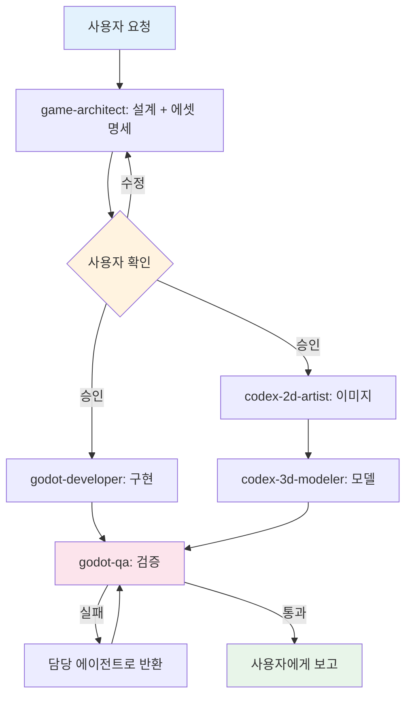

# dongval — Godot 3D 게임

- 엔진: Godot 4.7.2 (`godot` CLI), 언어: GDScript(정적 타입)
- 3D 도구: Blender 5.2.1 (`blender -b -P <script>`)
- 리소스 생성: Codex CLI (`codex exec`, ChatGPT 로그인)

## 에이전트 팀

메인 세션이 리드다. 리드는 작업을 쪼개 아래 에이전트에게 맡기고, 결과를 모아 사용자에게 보고한다. 서브에이전트는 다른 서브에이전트를 부를 수 없으므로 순서 조율은 항상 리드가 한다.

| 에이전트 | 실행 모델 | effort | 역할 |
|---|---|---|---|
| `game-architect` | Claude Opus | high | GDD, 씬/시스템 설계, 에셋 명세서 |
| `godot-developer` | Claude Sonnet | high | GDScript, .tscn/.tres, 셰이더 구현 |
| `godot-qa` | Claude Opus | medium | 설계 대비 검증, 헤드리스 실행 검사 (수정 안 함) |
| `codex-2d-artist` | Codex gpt-6.1-sol (위임자는 Haiku/low) | medium | 컨셉아트, 텍스처, UI 이미지 |
| `codex-3d-modeler` | Codex gpt-6.1-sol (위임자는 Haiku/low) | high | Blender 스크립트로 모델 생성 → .glb |

## 작업 흐름

새 기능은 설계에서 시작한다. 설계가 끝나면 사용자 확인을 한 번 받고, 구현과 에셋 제작을 병렬로 진행한 뒤 QA가 검증한다. QA가 실패를 보고하면 해당 담당에게 되돌린다(최대 2회, 그 뒤에는 사용자에게 보고).

## 디렉터리 규약

- `docs/` 설계 문서 (한글) · `docs/assets/` 에셋 명세서
- `scenes/`, `scripts/`, `shaders/`, `tests/`
- `assets/concept/`, `assets/textures/`, `assets/ui/`, `assets/models/`
- `tools/blender/` 모델 생성 스크립트 · `.claude/codex-tasks/` Codex 지시서 기록
