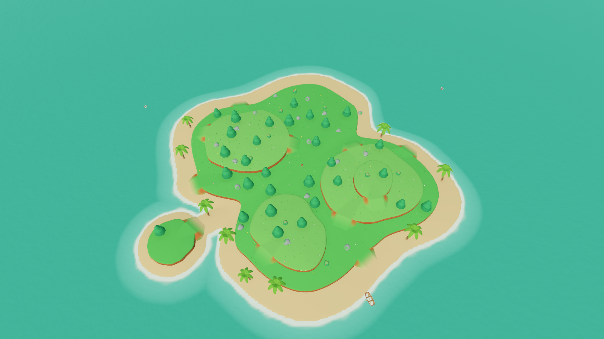
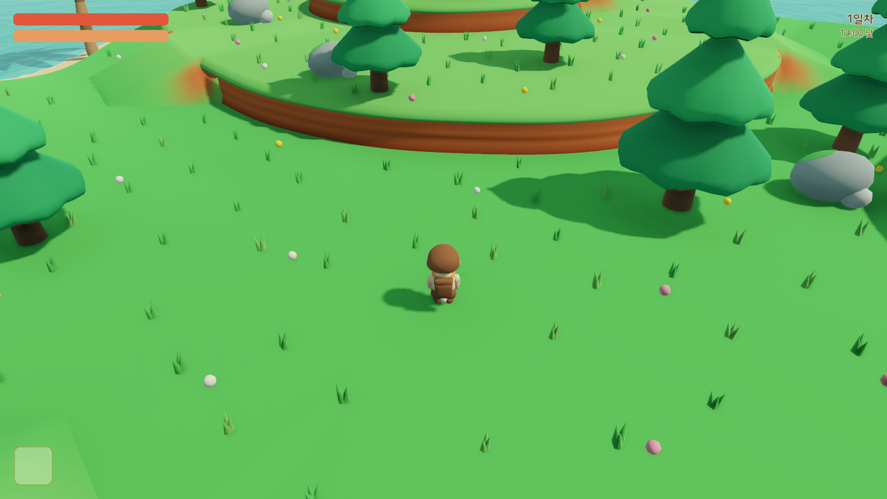

# Islander

무인도에 떨어진 꼬마 탐험가가 나무와 돌을 모아 도구를 만들고, 배고픔과 밤의 슬라임을 견디는 3D 생존 크래프트 게임입니다. 둥글고 두툼한 장난감 같은 섬 디오라마 스타일을 목표로 Godot 4.7로 만들고 있습니다. 지금은 플레이 가능한 MVP 단계입니다.

| 섬 전체 | 플레이 화면 |
|---|---|
|  |  |

## 게임 내용

- **섬:** 여러 갈래로 나뉜 섬과 모래톱으로 이어진 작은 섬이 있습니다. 3단 잔디 고원은 지층 띠가 있는 흙 절벽으로 나뉘고, 경사로로 오갑니다. 같은 시드에서는 항상 같은 섬이 만들어집니다.
- **채집과 제작:** 나무와 바위를 쳐서 나무·돌을 얻고, 덤불에서 베리를 땁니다. 재료를 처음 얻으면 레시피가 열립니다. 돌도끼·돌곡괭이를 들면 해당 자원의 채집량이 3배가 됩니다.

  | 레시피 | 재료 |
  |---|---|
  | 돌도끼 | 나무 3, 돌 2 |
  | 돌곡괭이 | 나무 3, 돌 3 |
  | 나무창 | 나무 4 |

- **생존:** 배고픔은 시간이 지나면 줄고 달리면 3배 빨리 줄어듭니다. 0이 되면 체력이 서서히 깎이고, 베리를 먹으면 회복됩니다.
- **몬스터:** 게는 해변을 순찰하다가 가까이 가면 공격합니다. 슬라임은 밤에 나타나 쫓아오고 아침이 되면 사라집니다.
- **시간:** 하루는 6분(낮 4분, 밤 2분)입니다. 체력이 0이 되면 같은 섬에서 처음부터 다시 시작합니다.

## 조작

| 키 | 동작 |
|---|---|
| W / A / S / D | 이동 (카메라 기준) |
| Shift | 달리기 |
| 마우스 이동 | 시점 회전 |
| 마우스 휠 | 확대·축소 |
| 마우스 왼쪽 | 공격, 나무·바위 채집 |
| E | 베리 따기 |
| Tab | 인벤토리 (슬롯 클릭: 장착·먹기) |
| C | 제작 |
| Esc | 패널 닫기 / 마우스 해제 (게임 화면 클릭으로 다시 잡기) |

## 실행

필요한 것:

- [Godot](https://godotengine.org/) 4.7 이상 (`godot` 명령이 PATH에 있어야 함)
- [Task](https://taskfile.dev/) (선택. 없으면 아래 godot 명령을 직접 실행)

```bash
git clone https://github.com/gyuha/islander.git
cd islander
task          # 게임 실행 (= godot --path .)
```

| 명령 | 하는 일 |
|---|---|
| `task run` | 게임 실행 |
| `task editor` | Godot 에디터 열기 |
| `task test` | 헤드리스 테스트 실행 |
| `task check` | import → 테스트 → 600프레임 헤드리스 실행 |
| `task capture` | 낮·섬 전체·밤 스크린샷을 `captures/`에 저장 (창이 열림) |

처음 열면 Godot가 에셋을 임포트하므로 시작이 조금 걸립니다.

## 프로젝트 구조

```
autoload/        WorldClock(시간·낮밤), ItemDB(아이템·레시피 로드)
data/            아이템 Resource(.tres), 레시피 JSON
scripts/         플레이어, 지형 생성, 적 AI, UI, 제작
  vendor/gdskills/   스킬에서 가져와 고친 스크립트 (LGPL-3.0)
scenes/          메인, 플레이어, 월드, 적, UI 씬
shaders/         물 셰이더
assets/          모델(.glb), 아이콘, 폰트, 테마, 컨셉 이미지
tools/blender/   모델 생성 Blender 스크립트
tests/           헤드리스 테스트 (35개)
docs/            기획서, 아키텍처, 아트 가이드, 에셋 명세
```

시스템은 데이터(Resource·JSON), 전역 상태(Autoload), 행동(씬 컴포넌트)의 세 층으로 나뉘고, 컴포넌트끼리는 시그널로 연결됩니다. 자세한 구조와 시그널 흐름은 [docs/architecture/README.md](docs/architecture/README.md)에 있습니다.

| 문서 | 내용 |
|---|---|
| [docs/gdd.md](docs/gdd.md) | 게임 기획, 조작, 수치 튜닝표 |
| [docs/architecture/](docs/architecture/) | 시스템별 설계 |
| [docs/art/style-guide.md](docs/art/style-guide.md) | 팔레트, 조명, 카메라, 물 |
| [docs/assets/](docs/assets/) | 모델·아이콘 명세 |

## 개발 방식

이 프로젝트는 역할을 나눈 AI 에이전트 팀으로 만들었습니다. 정의는 `.claude/agents/`에 있고, 운영 규칙은 [CLAUDE.md](CLAUDE.md)에 있습니다.

| 에이전트 | 모델 | 역할 |
|---|---|---|
| `game-architect` | Claude Opus | 기획서, 시스템 설계, 에셋 명세 |
| `godot-developer` | Claude Sonnet | GDScript, 씬, 셰이더 구현 |
| `godot-qa` | Claude Opus | 설계 대비 검증 (파일 수정 안 함) |
| `codex-2d-artist` | Codex (gpt-image) | 컨셉 아트, 아이콘 |
| `codex-3d-modeler` | Codex + Blender | Blender 스크립트로 모델 생성 → .glb |

시스템 설계는 [Game-Dev-Agentic-Skills](https://github.com/thedivergentai/Game-Dev-Agentic-Skills)의 `godot-master` 스킬(`.claude/skills/godot-master/`)에 있는 생존 장르 구조를 따릅니다.

모델을 다시 만들려면 Blender 5.2 이상이 필요합니다.

```bash
blender -b --factory-startup -P tools/blender/<name>.py
```

## 알려진 한계

- **카메라:** 나무 잎에는 충돌 판정이 없어서, 카메라가 잎 안으로 들어갈 수 있습니다.
- **화면 톤:** 넓은 잔디가 한 가지 색이고 포인트 색이 적어서, 목표로 하는 디오라마 느낌에는 아직 못 미칩니다.
- **MVP에 없는 기능:** 저장·불러오기, 건축, 소리, 게임패드는 아직 없습니다.

## 라이선스와 크레딧

이 프로젝트 자체의 라이선스는 아직 정하지 않았습니다. 포함된 서드파티 자료는 각자의 라이선스를 따릅니다.

- **나눔스퀘어라운드 폰트** (`assets/fonts/`): © NAVER Corp., SIL Open Font License 1.1 ([OFL.txt](assets/fonts/OFL.txt))
- **godot-master 스킬과 거기서 가져온 스크립트** (`.claude/skills/godot-master/`, `scripts/vendor/gdskills/`): [Game-Dev-Agentic-Skills](https://github.com/thedivergentai/Game-Dev-Agentic-Skills), LGPL-3.0 ([LICENSE](.claude/skills/godot-master/LICENSE))
- **모델·아이콘·컨셉 이미지:** Codex(gpt-image)와 Blender 스크립트로 생성
