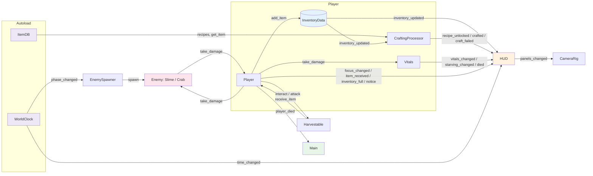

# 아키텍처 개요

Godot 4.7 / GDScript(정적 타입)로 만든 3D 생존 크래프트 MVP의 구조 문서다. 시스템 설계는 프로젝트 스킬 `godot-master`의 `genre-survival` 구조(Autoload·Resource·컴포넌트 분리와 NEVER 규칙)를 따른다. 시스템별 상세는 아래 표의 문서에 있다.

| 문서 | 범위 |
|---|---|
| [data-inventory-crafting.md](data-inventory-crafting.md) | ItemData, InventoryData, 레시피 JSON, ItemDB, CraftingProcessor |
| [world-island.md](world-island.md) | IslandLayout, IslandGenerator, 경사로, 배치, 내비, 물 |
| [player-vitals-interaction.md](player-vitals-interaction.md) | Player, CameraRig, Vitals, Interactable, Harvestable, 물리 레이어 |
| [enemies-ai.md](enemies-ai.md) | Enemy 상태 머신, Slime, Crab, SmartNavigationAgent, EnemySpawner |
| [worldclock-ui.md](worldclock-ui.md) | WorldClock, 조명 전환, HUD, 인벤토리/제작 패널, 테마·폰트 |
| [testing-capture.md](testing-capture.md) | 헤드리스 테스트 러너, 캡처 모드, Main |
| [../gdd.md](../gdd.md) | 게임 개요, 조작, 수치 튜닝표 |
| [../art/style-guide.md](../art/style-guide.md) | 색, 환경, 카메라, 물 |
| [../assets/](../assets/) | 에셋별 명세(크기, 피벗, 삼각형 예산, 색) |

## 설계 원칙

시스템은 세 층으로 나뉜다.

- **데이터:** 아이템은 Resource(`data/items/*.tres`), 레시피는 JSON(`data/recipes.json`)이다. 아이템을 Node로 만들지 않는다.
- **전역 상태:** Autoload `WorldClock`(시간·낮밤)과 `ItemDB`(아이템·레시피 로드)만 둔다.
- **행동:** 씬에 붙는 컴포넌트(`Player`, `Vitals`, `CraftingProcessor`, `Harvestable`, `Enemy` 등)다.

규칙:

- 컴포넌트끼리는 시그널로 연결한다. UI는 값을 폴링하지 않고 시그널을 받아 갱신한다.
- 테스트할 로직은 순수 static 함수나 `tick()`, 주입한 Callable로 분리해서 씬 트리 없이 검증한다.
- 섬 생성은 `WorkerThreadPool`에서 하고, 노드 생성·메시·충돌·내비 등록은 `call_deferred`로 메인 스레드에서 한다. 시드는 고정이다(섬 `20261028`, 스포너 `+100`, 슬라임 `+1000+번호`).
- 스킬 스크립트는 `scripts/vendor/gdskills/`로 복사해 고쳐 쓰고, 첫 줄에 `# Origin: … (LGPL-3.0)` 출처 주석을 단다.

## project.godot 설정

| 키 | 값 |
|---|---|
| `application/run/main_scene` | `res://scenes/main.tscn` |
| `rendering/renderer/rendering_method` | `forward_plus` |
| `display/window/size/viewport_width × height` | 1600 × 900 |
| `rendering/anti_aliasing/quality/msaa_3d` | `2` (4x) |
| Autoload | `WorldClock` = `res://autoload/world_clock.gd`, `ItemDB` = `res://autoload/item_db.gd` (이 순서) |
| 3D 물리 레이어 이름 | 1 `world`, 2 `player`, 3 `enemy`, 4 `interact` |
| InputMap | `move_forward` W, `move_back` S, `move_left` A, `move_right` D, `sprint` Shift, `interact` E, `attack` 마우스 왼쪽, `toggle_inventory` Tab, `toggle_crafting` C, `camera_zoom_in` 휠 위, `camera_zoom_out` 휠 아래. `ui_cancel`(Esc)은 Godot 기본 액션을 쓴다 |
| `gui/theme/custom` | `res://assets/ui/theme.tres` (기본 폰트 NanumSquareRoundR) |

## 씬 구조

`main.tscn`이 모든 시스템을 조립한다. 플레이어는 인벤토리·생존 수치·제작을 자식 컴포넌트로 직접 소유하고, 카메라는 플레이어와 분리된 `CameraRig`가 따라가며 마우스 모드를 소유한다.

```
Main (Node3D, scripts/main.gd)
├─ WorldEnvironment            # Environment + ProceduralSkyMaterial (style-guide 값)
├─ Sun (DirectionalLight3D)    # WorldClock이 낮/밤 보간
├─ Island (scenes/world/island.tscn, IslandGenerator)
│  └─ NavRegion …              # 생성 후 지형 메시·충돌·내비·채집물·장식이 붙음
├─ Water (scenes/world/water.tscn, water.gdshader)
├─ Player (scenes/player/player.tscn, CharacterBody3D, group "player")
│  ├─ CollisionShape3D         # 캡슐 r 0.3, h 0.9
│  ├─ Visual
│  │  └─ Model                 # player_human.glb (Body/Head/ArmL/ArmR/ToolSocket/LegL/LegR)
│  ├─ HitCast (ShapeCast3D)    # 공격·상호작용 대상 판정, 방향은 카메라 수평 정면
│  ├─ Vitals                   # 체력·배고픔
│  └─ CraftingProcessor        # 레시피 해금·제작
├─ CameraRig (scenes/player/camera_rig.tscn)   # Pitch → SpringArm3D → Camera3D
├─ Enemies (Node3D)            # 생성된 적이 붙는 곳
├─ EnemySpawner (Node3D)       # 게 상주, 밤에 슬라임 생성
└─ HUD (scenes/ui/hud.tscn)    # 바, 시계, 프롬프트, 토스트, 인벤토리/제작 패널
```

`InventoryData`는 노드가 아니라 `Player._ready()`에서 `InventoryData.create(20)`으로 만드는 Resource다. 같은 함수에서 `CraftingProcessor.configure(inventory, ItemDB.recipes, ItemDB.get_item)`으로 제작기에 주입한다.

## 시작 순서

`Main`은 섬이 다 만들어질 때까지 플레이어를 멈춰 두고(`PROCESS_MODE_DISABLED`), 생성이 끝나면 플레이어를 배치하고 스포너를 켠다. 섬 생성은 워커 스레드 계산 → 메인 스레드 등록 → 내비 베이크 → 내비 맵 동기화 대기 순서로 진행하고, 마지막에 `generated(spawn_point)`를 보낸다.

```
Main._ready → 시그널 연결, Player 정지
   → IslandGenerator: 워커에서 레이아웃·높이·메시·배치 계산
   → 메인 스레드에서 메시·충돌·채집물 등록 → 내비 베이크 → 맵 동기화 대기
   → generated(spawn_point)
   → Main: 플레이어 배치, 카메라 자세 설정, Player 재개, EnemySpawner.activate()
```

## 런타임 시그널 흐름

입력은 `Player`가 받고, 결과는 시그널로 HUD와 다른 시스템에 퍼진다. 시간은 `WorldClock`이 단독으로 소유하며, 낮밤 전환이 조명과 적 생성을 움직인다. 아래 그림은 주요 시그널만 담았다.



## 파일 목록

`.import`, `.uid` 파일과 `docs/`는 생략했다. 화살표(←)는 원본 스킬 스크립트다(`.claude/skills/godot-master/scripts/`).

```
project.godot
Taskfile.yml                                      # task run / test / check / capture
autoload/world_clock.gd
autoload/item_db.gd
data/items/{wood,stone,berry,stone_axe,stone_pickaxe,wooden_spear}.tres
data/recipes.json
scripts/main.gd
scripts/vendor/gdskills/item_data.gd              ← inventory_system_inventory_item_resource.gd (InventoryItem → ItemData)
scripts/vendor/gdskills/item_slot.gd              ← inventory_system_item_slot_data.gd
scripts/vendor/gdskills/inventory_data.gd         ← inventory_system_inventory_data_resource.gd
scripts/vendor/gdskills/interactable.gd           ← genre_survival_interactable.gd
scripts/vendor/gdskills/vitals.gd                 ← genre_survival_status_depletion_manager.gd (StatusDepletionManager → Vitals)
scripts/vendor/gdskills/smart_navigation_agent.gd ← navigation_pathfinding_smart_navigation_agent.gd
scripts/vendor/gdskills/island_noise.gd           ← procedural_generation_fast_noise_noise2d_master.gd (+ class_name IslandNoise)
scripts/vendor/gdskills/poisson_disk_sampler.gd   ← procedural_generation_poisson_disk_sampling_2d.gd (+ class_name PoissonDiskSampler)
scripts/crafting/crafting_processor.gd            ← genre_survival_crafting_recipe_processor.gd 흐름 (→ CraftingProcessor)
scripts/world/island_layout.gd
scripts/world/island_generator.gd
scripts/world/harvestable.gd
scripts/player/player.gd
scripts/player/camera_rig.gd
scripts/enemies/{enemy,slime,crab,enemy_spawner}.gd
scripts/ui/{hud,slot_widget,inventory_panel,crafting_panel,recipe_row}.gd
scenes/main.tscn
scenes/player/{player,camera_rig}.tscn
scenes/world/{island,water,pine_tree,palm_tree,rock,berry_bush,boat,buoy}.tscn
scenes/enemies/{slime,crab}.tscn
scenes/ui/{hud,slot_widget,inventory_panel,crafting_panel,recipe_row}.tscn
shaders/water.gdshader
assets/ui/theme.tres
assets/ui/icons/{wood,stone,berry,stone_axe,stone_pickaxe,wooden_spear}.png
assets/fonts/NanumSquareRound{R,B}.ttf
assets/fonts/OFL.txt                              # 폰트 라이선스 (필수)
assets/models/{pine_tree,palm_tree,rock,berry_bush,player_human,slime,crab,boat,buoy}/<name>.glb
assets/concept/{concept_sheet,player_human_turnaround}.png
tools/blender/<name>.py                           # 모델 생성 스크립트 (blender -b --factory-startup -P)
tools/blender/preview.py                          # glb 미리보기 렌더
tests/run_tests.gd
tests/test_case.gd
tests/test_{inventory,crafting,harvest,vitals,island,spawner}.gd
captures/.gdignore
```

- **쓰지 않는 파일:** `assets/models/player_bunny/`, `tools/blender/player_bunny.py`는 주인공을 사람으로 바꾸기 전의 토끼 모델이다. 어디서도 참조하지 않는다.
- **가져오지 않은 스킬 스크립트:** `genre_survival_inventory_data.gd`(`InventoryData` 이름 중복), `genre_survival_modular_inventory_controller.gd`(무제한 슬롯), `genre_survival_survival_patterns.gd`(필요한 패턴만 인라인), `AIPathingSystem`(AStar 2D 전용), 절차 생성 메셔(스텁).

## class_name 목록

프로젝트 안에서 유일해야 한다.

`ItemData`, `ItemSlot`, `InventoryData`, `CraftingProcessor`, `Interactable`, `Harvestable`, `Vitals`, `Player`, `CameraRig`, `IslandLayout`, `IslandGenerator`, `IslandNoise`, `PoissonDiskSampler`, `SmartNavigationAgent`, `Enemy`, `Slime`, `Crab`, `EnemySpawner`, `HUD`, `SlotWidget`

Autoload 스크립트(`world_clock.gd`, `item_db.gd`)에는 싱글톤 이름과 충돌하므로 class_name을 붙이지 않는다. 테스트 파일에도 붙이지 않는다.

## 검증

변경 후에는 `task check`를 실행한다. import → 테스트 → 600프레임 헤드리스 실행을 차례로 돌린다. 테스트 출력의 `ERROR: CraftingProcessor: 레시피 'bad' 건너뜀 …` 한 줄은 잘못된 레시피를 거르는지 확인하는 테스트가 일부러 낸 것이다.

| 테스트 파일 | 개수 | 범위 |
|---|---|---|
| `test_inventory.gd` | 5 | 스택 64, 슬롯 20, 무게, 제거 |
| `test_crafting.gd` | 5 | 재료 부족 시 무소모, 정확한 소모·지급, 발견 해금, 도구 등급 수확량 |
| `test_harvest.gd` | 6 | 가방이 가득 찰 때 채집(무소모·일부 지급), 베리 남은 수확량, E 대상 여부 |
| `test_vitals.gd` | 3 | 달리기 3배 감소, 굶주림 체력 감소, 섭취 회복 |
| `test_island.gd` | 14 | 고정 시드, 단 수·면적, 절벽 높이, 윤곽 매끈함, 경사로, 내비 연결, 배치 최소치 |
| `test_spawner.gd` | 2 | 안전 반경, 재시도 횟수 제한 |

헤드리스에서는 마우스 캡처를 시험할 수 없다. 시점 회전, 패널을 열 때의 마우스 모드, SpringArm 충돌은 `task run`으로 직접 확인한다. 화면 톤은 `task capture`로 `captures/{day,overview,night}.png`를 만들어 참조 이미지와 비교한다.

## 빌드 이력

MVP는 아래 순서로 만들었다. 단계마다 import·실행 오류 0과 해당 테스트 통과를 조건으로 다음 단계로 넘어갔다. 모두 완료했다.

1. **골격:** project.godot, 디렉터리, Autoload 2개
2. **데이터·인벤토리·제작:** vendored 데이터 스크립트, `.tres` 6개, recipes.json, ItemDB, CraftingProcessor, 테스트 러너
3. **지형·배치:** IslandGenerator, 물 셰이더, 내비 베이크. 이후 IslandLayout 기반 재설계(로브, 3단 고원, 절벽, 경사로)로 교체
4. **플레이어·Vitals·채집:** Player, CameraRig(3인칭 SpringArm), Vitals, Interactable, Harvestable
5. **시간·UI:** WorldClock 조명, HUD와 패널, 나눔스퀘어라운드 테마, 캡처 모드
6. **몬스터:** SmartNavigationAgent, Enemy/Slime/Crab, EnemySpawner
7. **에셋 교체:** glb·아이콘 연결, 경사로 외형, 환경값 조정, QA 1차 수정

```
골격 → 데이터·제작 → 지형·배치 → 플레이어·채집 → 시간·UI → 몬스터 → 에셋 교체 → QA 수정
```
