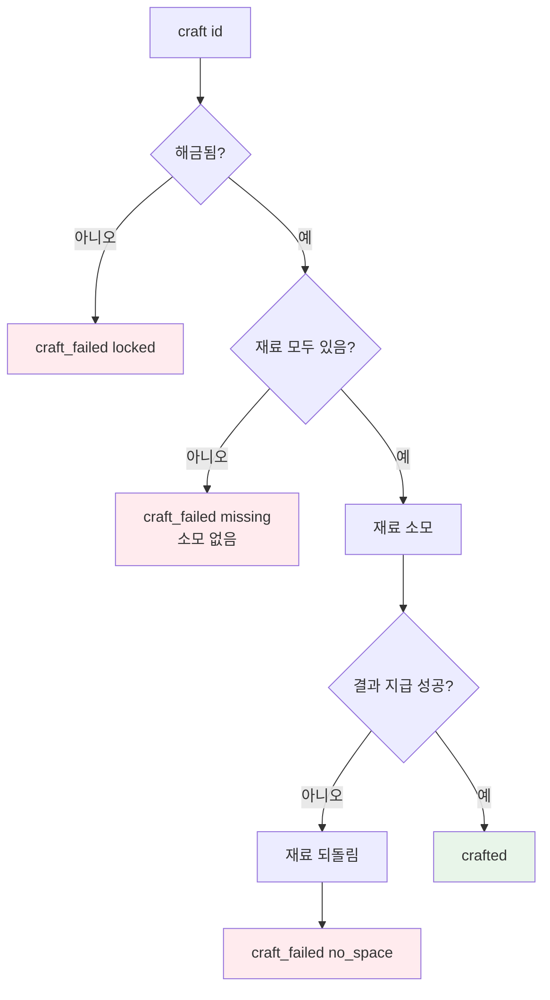

# 데이터 · 인벤토리 · 제작

## 개요

아이템은 Resource(`ItemData`, `.tres`), 레시피는 JSON, 인벤토리는 Resource(`InventoryData`)다. 노드가 아닌 데이터라서 테스트에서 씬 트리 없이 다룰 수 있다. 전역 조회는 Autoload `ItemDB`가 맡고, 제작 로직(`CraftingProcessor`)은 Autoload에 의존하지 않도록 조회 함수를 주입받는다(헤드리스 테스트에서 Autoload를 쓰지 않기 위함).

```
data/items/*.tres ─┐
                   ├→ ItemDB (Autoload) ─→ Player.receive_item → InventoryData.add_item
data/recipes.json ─┘                                          ↓ item_added
                                         CraftingProcessor (발견 기록 → 해금 → 제작)
```

## 파일

| 경로 | 클래스 | 출처 |
|---|---|---|
| `scripts/vendor/gdskills/item_data.gd` | `ItemData extends Resource` | `inventory_system_inventory_item_resource.gd` (`InventoryItem` → `ItemData`로 이름 변경) |
| `scripts/vendor/gdskills/item_slot.gd` | `ItemSlot extends Resource` | `inventory_system_item_slot_data.gd` |
| `scripts/vendor/gdskills/inventory_data.gd` | `InventoryData extends Resource` | `inventory_system_inventory_data_resource.gd` |
| `scripts/crafting/crafting_processor.gd` | `CraftingProcessor extends Node` | `genre_survival_crafting_recipe_processor.gd`의 흐름만 (`CraftingRecipeProcessor` → `CraftingProcessor`) |
| `autoload/item_db.gd` | (class_name 없음, Autoload 이름 `ItemDB`) | 신규 |
| `data/items/{wood,stone,berry,stone_axe,stone_pickaxe,wooden_spear}.tres` | `ItemData` 인스턴스 | 신규 |
| `data/recipes.json` | — | 신규 |

### 출처 주석 (vendored 파일 상단 공통)

```gdscript
# Origin: gd-agentic-skills (LGPL-3.0) — .claude/skills/godot-master/scripts/<원본 파일명>
# Modified for dongval: <변경 요약 한 줄>
```

### class_name 충돌 정리

- 스킬의 `genre_survival_inventory_data.gd`(`InventoryData`)는 **가져오지 않는다**. 프로젝트 안의 `InventoryData`는 inventory_system 쪽 한 개뿐이다.
- 스킬의 `resource_data_patterns_custom_data_resource.gd`도 `class_name ItemData`를 쓰지만 가져오지 않으므로 프로젝트 안에서는 충돌하지 않는다.
- `.claude/`는 숨김 폴더라 Godot 임포트 대상이 아니다 [중간]. 첫 `--import` 출력에 class_name 중복 경고가 나오면 `.claude/.gdignore`(빈 파일)를 추가한다.

## ItemData

원본 대비 변경: `class_name` 변경, `weight`·`consumables`·`tool_type`·`tool_tier`·`damage`·`reach` 추가, `max_stack` 기본값 99 → 64, `stackable` 기본값 false → true. `use()`는 삭제(섭취·장착은 Player가 처리).

```gdscript
class_name ItemData extends Resource
@export var id: StringName = &""
@export var name: String = ""            # 표시 이름(한글)
@export var icon: Texture2D               # res://assets/ui/icons/<id>.png (없으면 null 허용)
@export var stackable: bool = true
@export var max_stack: int = 64
@export var weight: float = 1.0
@export var consumables: Dictionary = {}  # { "hunger": 15.0 } — 비어 있지 않으면 음식
@export var tool_type: StringName = &""   # &"", &"axe", &"pickaxe", &"spear"
@export var tool_tier: int = 0
@export var damage: int = 0               # 공격 피해 (도구가 아니면 0 → 맨손 값 사용)
@export var reach: float = 0.0
@export_multiline var description: String = ""

func is_food() -> bool
func is_tool() -> bool                    # tool_type != &""
```

`.tres` 값은 `docs/gdd.md` 4장 아이템 표를 그대로 쓴다. 도구는 `stackable=false`, `max_stack=1`.

아이템 Resource는 공유 인스턴스다. MVP에 개체별 상태(내구도)가 없으므로 `duplicate()`하지 않는다. 내구도를 넣는 시점에 슬롯 단위로 `duplicate_deep()` 해야 한다.

## ItemSlot

원본 대비 변경:
- `signal changed` 선언 삭제 → `emit_changed()` 사용. `Resource`가 이미 `changed` 시그널을 가지고 있어 재선언은 오류다 [중간].
- `item` 타입 `InventoryItem` → `ItemData`, `quantity` 기본값 1 → 0.
- `func is_empty() -> bool` 추가 (`item == null or quantity <= 0`).

## InventoryData

원본 대비 변경: 타입 이름, 무게 초과 시 전량 거부 → **들어갈 만큼만 넣고 나머지 반환**, 스택 비교를 `slot.item.id == new_item.id`로, 아래 API 추가.

```gdscript
class_name InventoryData extends Resource

signal inventory_updated                                  # 한 번의 변경 호출당 최대 1회
signal item_added(item: ItemData, amount: int)            # 실제로 들어간 수량(>0)일 때만

@export var slots: Array[ItemSlot] = []
@export var max_weight: float = 200.0

static func create(slot_count: int = 20) -> InventoryData  # 빈 ItemSlot 20개로 채워 반환
func get_total_weight() -> float
func add_item(item: ItemData, count: int = 1) -> int        # 반환: 들어가지 못한 수량
func remove_item(item_id: StringName, count: int) -> bool   # 보유량 부족이면 아무것도 안 빼고 false
func remove_at(index: int, count: int = -1) -> void         # -1이면 슬롯 비움
func has_item(item_id: StringName, count: int = 1) -> bool
func count_of(item_id: StringName) -> int
func get_slot(index: int) -> ItemSlot
```

규칙:
- `add_item` 순서: 무게로 들어갈 수 있는 최대 수량 `floor((max_weight - total) / weight)`로 자른다 → 기존 스택 채우기 → 빈 슬롯. 남은 수량을 반환한다.
- `remove_item`은 뒤쪽 슬롯부터 뺀다(앞쪽 스택 유지). 0이 된 슬롯은 `item = null`.
- 수량은 항상 `int`. 시그널은 루프가 끝난 뒤 한 번만 낸다.

## 레시피 JSON

```json
{
  "recipes": [
    { "id": "stone_axe",     "result": "stone_axe",     "amount": 1, "ingredients": { "wood": 3, "stone": 2 } },
    { "id": "stone_pickaxe", "result": "stone_pickaxe", "amount": 1, "ingredients": { "wood": 3, "stone": 3 } },
    { "id": "wooden_spear",  "result": "wooden_spear",  "amount": 1, "ingredients": { "wood": 4 } }
  ]
}
```

JSON 숫자는 float로 읽히므로 파싱 시 `int()`로 변환한다. 알 수 없는 아이템 id, 수량 ≤ 0인 레시피는 `push_error` 후 건너뛴다.

## ItemDB (Autoload)

Autoload 스크립트에는 `class_name`을 붙이지 않는다(싱글턴 이름과 충돌).

```gdscript
extends Node  # autoload/item_db.gd, 이름 "ItemDB"
var items: Dictionary = {}               # StringName → ItemData
var recipes: Array[Dictionary] = []      # CraftingProcessor.parse_recipes 결과
func _ready() -> void                    # data/items/ 스캔 + recipes.json 로드
func get_item(id: StringName) -> ItemData   # 없으면 null + push_error
```

`data/items/` 스캔은 `DirAccess.get_files_at()`로 하고, 내보내기 빌드의 `.remap` 접미사를 떼고 `.tres`만 로드한다.

## CraftingProcessor

원본 흐름(전부 확인 → 소모 → 지급)은 유지하고, 비어 있던 `_has_item`/`_consume_item`을 `InventoryData`로 구현한다. `ModularInventoryController` 의존과 `ResourceLoader.load(output_path)`는 제거하고 id 기반 조회로 바꾼다. 발견(해금) 시스템을 추가한다.

```gdscript
class_name CraftingProcessor extends Node

signal recipe_unlocked(recipe_id: StringName)
signal crafted(recipe_id: StringName)
signal craft_failed(recipe_id: StringName, reason: StringName)   # &"locked", &"missing", &"no_space"

var inventory: InventoryData
var recipes: Array[Dictionary] = []
var discovered: Dictionary = {}          # item_id(StringName) → true
var _lookup: Callable                    # func(id: StringName) -> ItemData

static func parse_recipes(json_text: String, known_ids: Array[StringName]) -> Array[Dictionary]
func configure(inv: InventoryData, recipe_list: Array[Dictionary], item_lookup: Callable) -> void
func is_unlocked(recipe_id: StringName) -> bool
func can_craft(recipe_id: StringName) -> bool        # 해금 + 재료 충분
func craft(recipe_id: StringName) -> bool
func get_recipe(recipe_id: StringName) -> Dictionary
```

`craft()` 순서:

1. 해금 여부 확인 → 아니면 `craft_failed(locked)`.
2. 모든 재료를 `has_item`으로 확인 → 하나라도 부족하면 **아무것도 소모하지 않고** `craft_failed(missing)`.
3. 재료를 모두 `remove_item`.
4. 결과를 `add_item`. 남는 수량이 있으면 3에서 뺀 재료를 다시 넣고 `craft_failed(no_space)`. 재료가 비운 자리이므로 되돌리기는 성공한다(결과 수량 1 기준).
5. `crafted` 발생.

발견: `configure` 시 `inventory.item_added`에 연결한다. 새 item_id를 처음 받으면 `discovered`에 넣고, 그 결과로 모든 재료가 발견된 레시피마다 `recipe_unlocked`를 한 번 낸다.



배치: `Player` 씬의 자식 노드 `CraftingProcessor`. `Player._ready()`에서 `configure(inventory, ItemDB.recipes, ItemDB.get_item)` 호출.
