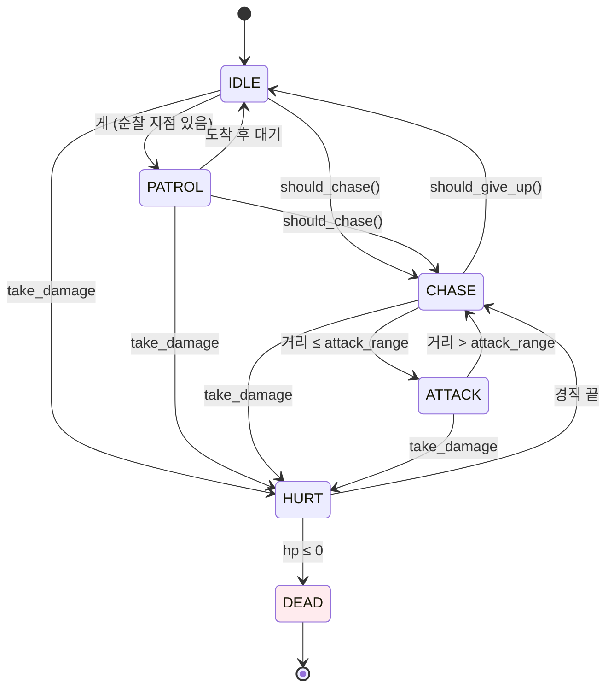
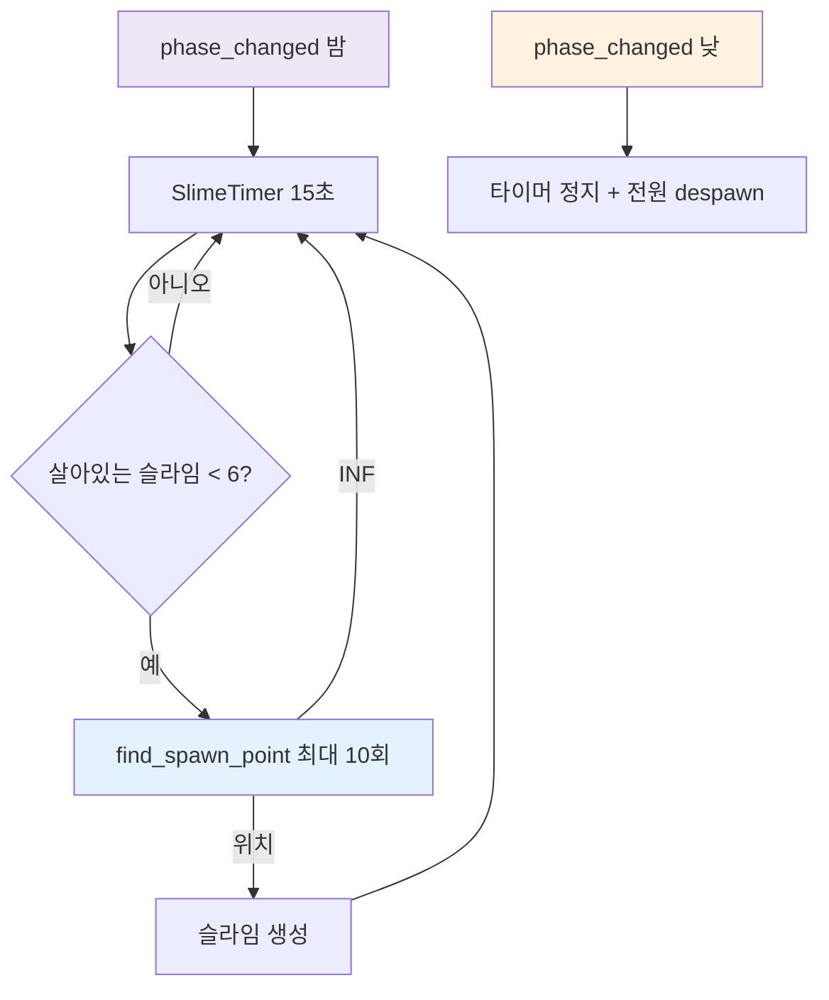

# 몬스터 · AI · 스포너

## 개요

적은 `Enemy`(CharacterBody3D) 하나의 기반 클래스에 열거형 상태 머신을 두고, 슬라임·게는 상태 진입 조건과 대기 행동만 재정의한다. 노드 기반 상태 머신은 상태 6개·몬스터 2종 규모에서 과하므로 쓰지 않는다. 길찾기는 vendored `SmartNavigationAgent`(NavigationAgent3D)로 하고, 스포너는 밤에 슬라임을, 시작 시 게를 만든다.



## 파일

| 경로 | 클래스 | 출처 |
|---|---|---|
| `scripts/enemies/enemy.gd` | `Enemy extends CharacterBody3D` | 신규 |
| `scripts/enemies/slime.gd`, `scenes/enemies/slime.tscn` | `Slime extends Enemy` | 신규 |
| `scripts/enemies/crab.gd`, `scenes/enemies/crab.tscn` | `Crab extends Enemy` | 신규 |
| `scripts/enemies/enemy_spawner.gd` | `EnemySpawner extends Node3D` | 신규 (안전 반경 패턴은 `genre-survival-key-mechanics.md`의 재귀 재추첨을 **횟수 제한 반복문**으로 바꿈) |
| `scripts/vendor/gdskills/smart_navigation_agent.gd` | `SmartNavigationAgent extends NavigationAgent3D` | `navigation_pathfinding_smart_navigation_agent.gd` (이름 유지) |

스킬의 `AIPathingSystem`(AStarGrid2D)은 2D 격자용이라 쓰지 않는다.

## SmartNavigationAgent 변경점과 사용 규칙

변경:
- `move_to()`: 맵이 아직 동기화되지 않았으면(`NavigationServer3D.map_get_iteration_id(get_navigation_map()) == 0`) `target_unreachable`을 내지 않고 목표만 설정.
- `update_movement()`: 반환 벡터의 y를 0으로(중력은 Enemy가 처리). 사용하지 않는 `delta` 매개변수는 `_delta`로.
- `check_for_obstacles()`는 그대로 두되 MVP에서 호출하지 않는다.

규칙:
1. 첫 목표 지정은 지연한다: `Enemy._ready()`에서 `_setup_nav.call_deferred()` → 그 안에서 `await get_tree().physics_frame` 후 첫 `move_to`.
2. 재탐색은 0.2초 간격: 자식 `RepathTimer`(Timer, 0.2초, 반복) timeout에서만 추적 목표 갱신. 매 프레임 `move_to` 금지.
3. 회피: `avoidance_enabled = true`, `radius = 0.5`(> 0), `max_speed`는 현재 상태 속도로 갱신, `neighbor_distance 5`, `max_neighbors 6`.
4. `path_desired_distance 0.5`, `target_desired_distance 0.8`.
5. 섬 생성 전에는 적을 만들지 않는다(스포너는 `IslandGenerator.generated` 이후 활성).

## Enemy API

```gdscript
class_name Enemy extends CharacterBody3D

enum State { IDLE, PATROL, CHASE, ATTACK, HURT, DEAD }

signal died(enemy: Enemy)
signal state_changed(state: State)

@export var max_hp: int = 30
@export var move_speed: float = 1.5
@export var chase_speed: float = 2.8
@export var attack_range: float = 1.1
@export var attack_damage: float = 8.0
@export var attack_cooldown: float = 1.2
@export var hurt_time: float = 0.25
@export var knockback_speed: float = 3.0
@export var gravity: float = 20.0

var state: State = State.IDLE
var hp: int
var target: Node3D                         # group "player"의 첫 노드

func take_damage(amount: int, from_pos: Vector3) -> void
func despawn() -> void                     # 스케일 0 Tween 0.4초 후 queue_free (died는 내지 않음)

# 하위 클래스 재정의
func _should_chase(dist: float) -> bool
func _should_give_up(dist: float) -> bool
func _idle_update(delta: float) -> void
func _visual_update(delta: float, moving: bool) -> void
```

`_physics_process` 순서: 중력 → `match state` → 수평 속도 결정(CHASE/PATROL은 `nav.update_movement`, HURT는 넉백 감쇠) → `move_and_slide()` → 이동 방향으로 `Visual` yaw 회전 → `_visual_update`.

- ATTACK: 이동 정지, 쿨다운마다 `target.take_damage(attack_damage)`. 거리 > `attack_range + 0.3`이면 CHASE.
- HURT: `hurt_time` 동안 `from_pos` 반대 방향 넉백, 모델 흰색 플래시(0.1초, `MeshInstance3D.material_overlay`에 흰색 무광 머티리얼 albedo 알파 Tween).
- DEAD: 충돌 비활성화, 스케일 0 Tween 0.4초, `died.emit(self)`, `queue_free()`.
- `Player.player_died`를 받으면 `target = null`로 두고 IDLE에 머문다(추적 중지).

## Slime

| 항목 | 값 |
|---|---|
| 그룹 | `"enemy"`, `"night_enemy"` |
| 수치 | GDD 튜닝표 슬라임 열 |
| `_should_chase` | dist ≤ 20 |
| `_should_give_up` | dist > 28 |
| 난수 | 배회용 RNG는 스포너가 `add_child` 전에 `rng_seed = island.seed + 1000 + 스폰 번호`로 지정한다(`randomize()` 금지) |
| IDLE | 2~4초마다 현재 위치 4 m 이내 임의 점으로 `move_to`(이동 속도 move_speed) |
| 연출 | 이동 중 `Body` 스쿼시 앤 스트레치: y 스케일 `1 + 0.15·sin(t·10)`, xz 반대. 깡충 높이 0.15 m |

```
Slime (CharacterBody3D, slime.gd)  layer 3
├─ CollisionShape3D            # SphereShape3D r 0.35, y 0.35
├─ Visual (Node3D)
│  └─ Model                    # slime.glb (없으면 SphereMesh, albedo 라벤더 #9C7BD6 = style-guide `slime`)
├─ Nav (NavigationAgent3D, smart_navigation_agent.gd)
└─ RepathTimer (Timer 0.2)
```

## Crab

| 항목 | 값 |
|---|---|
| 그룹 | `"enemy"` |
| 수치 | GDD 튜닝표 게 열 |
| `home` | 스폰된 해변 지점 |
| `patrol_points` | `home`과, 스포너가 준 `beach_points` 중 home에서 4~10 m인 점 최대 2개 |
| PATROL | 점 사이를 순서대로 왕복, 도착 시 IDLE 1.5초 |
| `_should_chase` | dist ≤ 6 이고 플레이어가 home에서 12 m 이내 |
| `_should_give_up` | 플레이어가 home에서 12 m 밖 → PATROL로 복귀 |
| 연출 | `Visual` 기준 모델을 y 90° 돌려 옆걸음(순찰·추적). **ATTACK 중에는 `Visual`을 돌려 집게(모델 +Z = Visual +X)가 대상을 향하게 한다**(`_face_attack`). 이동 중 `LegsL/LegsR` z축 ±15° 교차 흔들기, 공격 시 `ClawL/ClawR` x축 −40° 0.15초 집기 |

```
Crab (CharacterBody3D, crab.gd)  layer 3
├─ CollisionShape3D            # BoxShape3D 0.8×0.4×0.6, y 0.2
├─ Visual (Node3D)
│  └─ Model                    # crab.glb (없으면 빨강 BoxMesh)
├─ Nav (NavigationAgent3D, smart_navigation_agent.gd)
└─ RepathTimer (Timer 0.2)
```

## EnemySpawner

```gdscript
class_name EnemySpawner extends Node3D

signal enemy_spawned(enemy: Enemy)

@export var slime_scene: PackedScene
@export var crab_scene: PackedScene
@export var slime_interval: float = 15.0
@export var max_slimes: int = 6
@export var spawn_min_dist: float = 14.0
@export var spawn_max_dist: float = 28.0
@export var player_safe_radius: float = 12.0
@export var start_safe_radius: float = 10.0
@export var max_attempts: int = 10
@export var crab_count: int = 3
@export var crab_respawn_sec: float = 120.0
@export var crab_respawn_min_player_dist: float = 15.0

var rng: RandomNumberGenerator               # seed = island.seed + 100
var start_point: Vector3
var land_projector: Callable                 # func(p: Vector3) -> Vector3 ; 기본: 내비 최근접점
var last_attempts: int = 0                   # 테스트용: 마지막 find_spawn_point의 시도 횟수

func activate(island: IslandGenerator, player: Node3D) -> void   # generated 이후 Main이 호출
func find_spawn_point(player_pos: Vector3) -> Vector3            # 실패 시 Vector3.INF
```

`find_spawn_point` (재귀 금지, 횟수 제한 반복):

```
for i in max_attempts:
    angle = rng.randf() * TAU ; dist = rng.randf_range(spawn_min_dist, spawn_max_dist)
    c = player_pos + (cos, 0, sin) * dist
    p = land_projector.call(c)            # 기본: NavigationServer3D.map_get_closest_point
    last_attempts = i + 1
    if c와 p의 xz 거리 > 1.0: continue     # 바다 위 후보
    if p.distance_to(player_pos) < player_safe_radius: continue
    if p.distance_to(start_point) < start_safe_radius: continue
    return p
return Vector3.INF
```

`find_spawn_point`는 씬 트리·노드 위치에 접근하지 않는다(매개변수와 `land_projector`만 사용) → 테스트에서 트리 없이 호출한다.

동작:
- `WorldClock.phase_changed(true)`(밤): `SlimeTimer` 시작, 즉시 1회 스폰 시도. 살아 있는 `night_enemy`가 `max_slimes` 미만일 때만 스폰. 실패(INF)면 이번 틱은 건너뛴다.
- `phase_changed(false)`(낮): 타이머 정지, `night_enemy` 그룹 전원 `despawn()`.
- 게: `activate` 시 `island.beach_points`에서 서로 다른 지점 `crab_count`개에 생성. 게가 죽으면 `crab_respawn_sec` 뒤 플레이어에서 15 m 이상 떨어진 해변 지점에 1마리 재생성(조건 만족 지점이 없으면 10초 뒤 재시도).
- 생성된 적은 `Enemies`(Node3D, 스포너의 형제) 아래에 넣는다.
- **미결정 — 스폰 순간 노출**: 고정 쿼터뷰(화면 가로 ~28 m)에서는 14 m 이상 스폰이 화면 밖이었다. 3인칭 궤도 카메라는 시작 자세에서도 앞 ~22 m까지, pitch를 올리면 더 멀리 보이므로 슬라임이 눈앞에서 갑자기 나타날 수 있다. 선택지: (a) 그대로 둠, (b) 스폰 시 `Visual` 스케일 0→1 0.4초 Tween(땅에서 솟아나는 연출, `despawn()`의 스케일 0 Tween과 대칭), (c) 카메라 시야 밖(`Camera3D.is_position_in_frustum`이 false) 후보만 허용. 추천 (b): 코드 몇 줄이고 `find_spawn_point`의 순수 함수성·테스트를 건드리지 않는다. (c)는 카메라 의존이 생겨 트리 없는 테스트가 깨진다.


