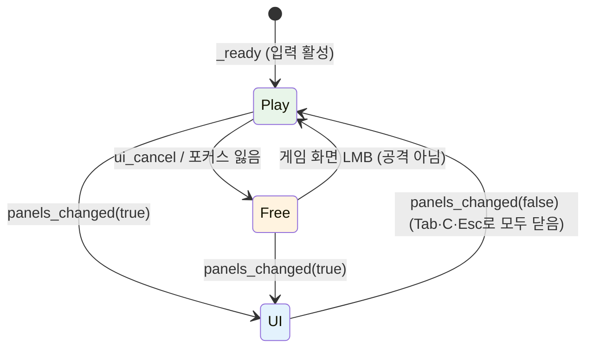

# 플레이어 · Vitals · 상호작용/채집

## 개요

플레이어는 `CharacterBody3D` 하나에 컴포넌트 노드(Vitals, CraftingProcessor)를 붙인 구조다. 인벤토리는 Resource로 들고 있다. 앞쪽 판정은 `ShapeCast3D`(구) 하나로 공격과 상호작용을 함께 처리한다. 계획의 "레이캐스트"를 구 스윕으로 바꾼 이유는 높이 0.8 m인 덤불과 바닥 근처 대상을 가슴 높이 레이가 놓치기 때문이다. 스윕의 원점은 캐릭터, 방향은 카메라의 수평 정면(조준 방향)이다(결정 근거는 CameraRig 절). 카메라는 마우스로 도는 3인칭 궤도 카메라(`CameraRig`)이고 마우스 캡처 상태도 CameraRig가 단독으로 관리한다. 컴포넌트끼리는 시그널로 연결하고, HUD는 Player/Vitals 시그널만 듣는다.

```
마우스 → CameraRig(yaw/pitch/줌, 마우스 모드) ──get_yaw/get_forward──┐
입력 → Player(카메라 yaw 기준 이동·Vitals.activity 설정) ←────────────┘
     → LMB(캡처 중): 조준 방향으로 돌아섬 → 0.15초 뒤 ShapeCast 판정 → Enemy.take_damage / Harvestable.hit → receive_item → InventoryData
     → E:            조준 방향으로 돌아섬 → ShapeCast 첫 Interactable → interact(self)
Vitals.tick → vitals_changed / starving_changed / died → HUD, Main(재시작)
```

## 파일

| 경로 | 클래스 | 출처 |
|---|---|---|
| `scenes/player/player.tscn` | — | 신규 |
| `scripts/player/player.gd` | `Player extends CharacterBody3D` | 신규 |
| `scripts/player/camera_rig.gd`, `scenes/player/camera_rig.tscn` | `CameraRig extends Node3D` | 신규 |
| `scripts/vendor/gdskills/vitals.gd` | `Vitals extends Node` | `genre_survival_status_depletion_manager.gd` (`StatusDepletionManager` → `Vitals`) |
| `scripts/vendor/gdskills/interactable.gd` | `Interactable extends Area3D` | `genre_survival_interactable.gd` (이름 유지) |
| `scripts/world/harvestable.gd` | `Harvestable extends Interactable` | 신규 |

## 물리 레이어 (project.godot에 이름 등록)

| 번호 | 이름 | 사용 |
|---|---|---|
| 1 | `world` | 지형, 나무·바위 몸통(StaticBody3D), 보트 |
| 2 | `player` | 플레이어 몸체 |
| 3 | `enemy` | 적 몸체 |
| 4 | `interact` | `Interactable` Area3D |

- Player: layer 2, mask 1·3. Enemy: layer 3, mask 1·2·3. Interactable Area3D: layer 4, mask 0, `monitorable = true`, `monitoring = false`.
- `HitCast`(ShapeCast3D): mask 3·4, `collide_with_areas = true`, `collide_with_bodies = true`.
- `CameraRig/Pitch/SpringArm`(SpringArm3D): mask 1만.

## player.tscn 노드 트리

```
Player (CharacterBody3D, player.gd, group "player")
├─ CollisionShape3D            # CapsuleShape3D r 0.3, height 0.9, 위치 y 0.45
├─ Visual (Node3D)             # 이동 방향으로 yaw 회전
│  └─ Model                    # assets/models/player_human/player_human.glb 인스턴스. glb 안에 루트 PlayerHuman이 한 겹 더 있다
│     … Body{Head, ArmL, ArmR}, LegL, LegR (docs/assets/player_human.md, 귀 전용 파츠 없음, L = +X)
│     ArmR/ToolSocket(Node3D)  # 장착 도구 메시를 코드로 붙이는 위치 (회전 없음, 손 중심)
├─ HitCast (ShapeCast3D)       # SphereShape3D r 0.5, y 0.5, 조준 방향(카메라 수평 정면)으로 스윕
├─ Vitals (Node, vitals.gd)
└─ CraftingProcessor (Node, crafting_processor.gd)
```

모델은 glTF 관례대로 **+Z가 정면**이다. glb 임포트 시 계층 깊이가 달라질 수 있으므로 파츠는 경로나 모델 루트 이름이 아니라 `Visual.find_child("ArmR", true, false)`처럼 이름으로 찾는다(씬의 모델 노드 이름은 `Model`, glb 내부 루트는 `PlayerHuman`)(적 모델도 동일). 방향 `dir`을 향하는 yaw는 `atan2(dir.x, dir.z)`다. `Player`(CharacterBody3D) 자체는 회전하지 않고 `Visual`만 돈다. 따라서 `HitCast.target_position`(Player 로컬 = 월드 방향)은 매 물리 프레임 `camera_rig.get_forward() * (reach − 0.5)`로 갱신한다.

## Player API

```gdscript
class_name Player extends CharacterBody3D

signal equipped_changed(item: ItemData)          # null = 맨손
signal focus_changed(prompt: String)             # 빈 문자열 = 대상 없음, 바뀔 때만
signal item_received(item: ItemData, amount: int)
signal inventory_full
signal player_died

@export var walk_speed: float = 4.5
@export var sprint_speed: float = 7.0
@export var acceleration: float = 30.0
@export var gravity: float = 20.0
@export var hand_damage: int = 4
@export var hand_reach: float = 1.5
@export var attack_cooldown: float = 0.5
@export var attack_hit_delay: float = 0.15
@export var invuln_time: float = 0.5
@export var turn_speed: float = 12.0             # 이동 방향 회전 보간 계수
@export var face_lock_time: float = 0.3          # 공격·상호작용 후 조준 방향 유지 시간
@export var island_path: NodePath                # 물 경계 확인용 IslandGenerator
@export var camera_rig_path: NodePath            # 이동 기준 yaw, 조준 방향

var inventory: InventoryData                     # _ready: InventoryData.create(20)
var equipped: ItemData = null

func receive_item(item_id: StringName, amount: int) -> int   # 남은 수량 반환, 0 초과면 inventory_full
func take_damage(amount: float) -> void                       # 무적 중이면 무시 → vitals.take_damage
func use_slot(index: int) -> void                             # 도구=장착 토글, 음식=1개 섭취
func set_input_enabled(enabled: bool) -> void
func face_direction(dir: Vector3) -> void                     # Visual yaw를 dir로 즉시 설정 (조준 정렬, 스폰 시 Main이 카메라 정면으로 호출)
```

이동 규칙:
- `var input := Input.get_vector("move_left", "move_right", "move_forward", "move_back")`, `dir = Basis(Vector3.UP, camera_rig.get_yaw()) * Vector3(input.x, 0, input.y)`. W = 카메라 수평 정면, D = 카메라 오른쪽.
- 회전: 이동 중이고 조준 고정(`face_lock_time`)이 끝났으면 `Visual.rotation.y = lerp_angle(Visual.rotation.y, atan2(dir.x, dir.z), 1.0 - exp(-turn_speed * delta))`. 정지 중에는 마지막 방향 유지.
- 목표 위치 `global_position + dir * speed * delta`의 `island.get_height(x, z) < -0.3`이면 수평 속도를 0으로(물 경계).
- `Vitals.activity`: 입력 없음 → IDLE, 이동 → WALK, 이동 + `sprint` → SPRINT.
- 걷기 연출(코드): 이동 중 `LegL/LegR`·`ArmL/ArmR`를 x축 ±25°로 `sin(t * 12)` 흔들고 `Body`를 y로 0.03 m 바운스. 정지 시 0으로 보간.

공격(LMB, `_unhandled_input`):
1. `Input.mouse_mode != Input.MOUSE_MODE_CAPTURED`면 무시(해제 상태의 클릭은 CameraRig의 재캡처 몫). 쿨다운 중이면 무시. `face_direction(camera_rig.get_forward())`, 조준 고정 `face_lock_time` 시작. `ArmR`를 +80°→−40° 0.2초 Tween 후 0°로 복귀(0.15초). 모델 정면이 +Z라서 X축 +회전은 팔을 뒤로 들고 −회전은 앞으로 내리친다(이전 표기 −80°→+40°는 반대로 휘둘렀다).
2. `attack_hit_delay` 뒤 `HitCast.force_shapecast_update()` → 충돌체를 거리순으로 보고 **첫 번째 하나만** 처리.
3. 거리순 충돌체 중 **공격 가능한 첫 번째**(그룹 `"enemy"`의 노드 → `take_damage(dmg, global_position)`, `harvest_by_hit`인 `Harvestable` → `hit(self, tool_type, tool_tier)`)를 처리한다. 적은 `Enemy` 클래스가 아니라 그룹으로 판별한다(Player가 Enemy 클래스에 의존하지 않도록). 베리 덤불처럼 타격 대상이 아닌 것은 건너뛴다.
4. `dmg = equipped.damage if equipped and equipped.damage > 0 else hand_damage`. 사거리도 같은 규칙.

상호작용(E, 마우스 상태 무관): `face_direction(camera_rig.get_forward())`, 조준 고정 시작 → `HitCast` 결과 중 가까운 순으로 `usable_with_key()`가 true인 첫 `Interactable`에 `interact(self)`. `usable_with_key()`는 기본 `can_interact()`와 같고, 타격형 `Harvestable`(나무·바위)은 false라 E 대상에서 빠진다. 프롬프트(`focus_changed`, 매 물리 프레임 확인하되 **바뀔 때만**)는 E 대상이 있으면 그 대상의 `prompt_message`, 없으면 가장 가까운 타격형 대상의 것이다(E를 눌렀을 때 실제로 처리될 대상과 일치).

- 사망하면(`Vitals.died`) `use_slot`은 아무 일도 하지 않고, HUD는 열린 패널을 닫고 Tab/C 입력을 무시한다.
- 음식 섭취는 배고픔이 `max_hunger − 1` 이상이면 하지 않고 `notice("배가 불러요")` 토스트만 띄운다(음식이 체력도 올리면 예외).

장착: `equipped_changed` 발생 시 `ToolSocket` 아래 플레이스홀더 도구 메시를 교체한다(도끼·곡괭이·창은 BoxMesh 조합, 색은 style-guide 나무/돌 색. 소켓은 회전이 없으므로 도구는 손에서 위(+Y)로 뻗는 방향으로 만든다). 인벤토리에서 해당 아이템 수량이 0이 되면 자동 해제.

사망: `Vitals.died` → `set_input_enabled(false)` → `Visual`을 x축 90° 0.6초 Tween → `player_died` 발생. 재시작은 `Main`이 한다.

## camera_rig.tscn (3인칭 궤도 카메라)

마우스로 자유롭게 돌리는 3인칭 카메라다. 리그는 `top_level`이라 플레이어와 변환이 분리되어 있고, 위치만 플레이어 머리 위 피벗을 부드럽게 따라간다. 회전(yaw/pitch)은 입력 즉시 적용한다. `SpringArm3D`가 피벗에서 카메라 쪽으로 구를 쏴서 지형·나무 줄기·바위(레이어 1)에 닿으면 카메라를 앞으로 당긴다. 수치 기본값의 원본은 GDD 5절 "카메라" 표다.

```
CameraRig (Node3D, camera_rig.gd, top_level)   # position = 플레이어 + (0, pivot_height, 0) 추종, rotation.y = yaw
└─ Pitch (Node3D)                              # rotation.x = pitch
   └─ SpringArm (SpringArm3D)                  # spring_length = 현재 거리, shape SphereShape3D r 0.2, collision_mask 1(world), margin 0.05
      └─ Camera3D                              # 로컬 변환 항등(SpringArm이 위치를 덮어씀), fov 50, near 0.1, far 200, current true
```

- SpringArm3D는 자기 로컬 **+Z** 방향으로 캐스트하고 자식을 그 끝(충돌 시 충돌점 − margin)에 둔다. Camera3D는 −Z를 보므로 따로 돌리지 않아도 피벗을 바라본다. [높음]
- mask는 1(world)만: 플레이어(2)·적(3)·Interactable(4)은 카메라를 밀지 않는다(슬라임이 지나갈 때 카메라가 튀지 않게). 나무 수관(잎)에는 충돌체가 없어 낮은 pitch에서 카메라가 잎 메시 안으로 들어갈 수 있다 — MVP 허용.
- near 0.1: 스프링암이 카메라를 벽 가까이 당기므로 이전 값 1이면 가까운 물체가 잘린다.
- 수면 아래로 내려가지 않음: 플레이어 발 y ≥ −0.3(물 경계), 피벗 +0.9, pitch ≤ −5°, 거리 ≥ 3 → 카메라 y ≥ 0.6 + 3·sin 5° ≈ 0.86 > 0(수면 y 0). 별도 처리 불필요.

```gdscript
class_name CameraRig extends Node3D

@export var target_path: NodePath
@export var follow_speed: float = 10.0
@export var pivot_height: float = 0.9
@export var default_yaw_deg: float = 35.0
@export var default_pitch_deg: float = -35.0
@export var min_pitch_deg: float = -70.0
@export var max_pitch_deg: float = -5.0
@export var default_distance: float = 7.0
@export var min_distance: float = 3.0
@export var max_distance: float = 12.0
@export var zoom_step: float = 0.75
@export var zoom_speed: float = 10.0
@export var mouse_sensitivity: float = 0.15      # 도/픽셀

func get_yaw() -> float                          # 라디안
func get_forward() -> Vector3                    # 수평 정면 = -global_basis.z의 y를 0으로 한 정규화 벡터 = (−sin yaw, 0, −cos yaw)
func set_pose(yaw_deg: float, pitch_deg: float, distance: float) -> void   # 각도·거리(목표·현재 모두) 즉시 적용 + 위치를 타깃으로 스냅
func set_ui_open(open: bool) -> void             # HUD.panels_changed에 연결
func set_input_enabled(enabled: bool) -> void    # false: 마우스 VISIBLE, 회전·줌·재캡처 입력 무시 (캡처 모드)
```

동작:
- `_ready`: `set_pose(default_yaw_deg, default_pitch_deg, default_distance)`, 입력 활성이면 `Input.mouse_mode = MOUSE_MODE_CAPTURED`.
- `_physics_process`: `global_position = global_position.lerp(target.global_position + Vector3.UP * pivot_height, 1 - exp(-follow_speed * delta))`. `SpringArm.spring_length`를 `_target_distance`로 `1 - exp(-zoom_speed * delta)` 보간.
- 회전(`_unhandled_input`, 캡처 중에만): `InputEventMouseMotion.screen_relative`(창 스트레치 배율에 영향받지 않는 값) 사용. `yaw -= deg_to_rad(rel.x * mouse_sensitivity)`, `pitch = clamp(pitch - deg_to_rad(rel.y * mouse_sensitivity), min, max)`. 마우스를 오른쪽으로 → 시점 오른쪽, 위로 → 시점 위(반전 없음).
- 줌(캡처 중에만): `camera_zoom_in` → `_target_distance -= zoom_step`, `camera_zoom_out` → `+=`, `[min_distance, max_distance]`로 clamp. 패널이 열려 있을 때 휠은 UI 스크롤 몫이다.
- 물리 보간(physics interpolation)은 끈다(기본값). 위치는 물리 틱에서 플레이어와 같이 움직이므로 서로 떨리지 않는다. 고주사율 모니터에서 끊김이 문제 되면 `physics/common/physics_interpolation`을 켜고 리그 추종을 `_process` + `target.get_global_transform_interpolated()`로 옮긴다. [중간]

### 마우스 모드 (CameraRig 단독 소유)

`Input.mouse_mode`는 CameraRig만 바꾼다. 상태는 `_ui_open: bool`과 현재 `Input.mouse_mode` 두 값으로 충분하다(별도 열거형 없음). 패널 상태는 HUD가 `panels_changed(any_open)` 시그널로 알려 주고, Main이 이를 `set_ui_open`에 연결한다. Esc(`ui_cancel`)는 두 노드가 **서로 겹치지 않는 조건**에서만 처리한다. 패널이 열려 있으면 HUD가 처리해 패널을 닫고 `set_input_as_handled()`, 패널이 없고 캡처 중이면 CameraRig가 처리해 해제한다. 그래서 `_unhandled_input` 호출 순서와 무관하게 한 번만 반응한다.

| 현재 | 사건 | 결과 |
|---|---|---|
| 플레이(CAPTURED) | `ui_cancel` | 자유(VISIBLE) |
| 플레이 | `set_ui_open(true)` | UI(VISIBLE) |
| 플레이 | `NOTIFICATION_APPLICATION_FOCUS_OUT` (Alt-Tab 등) | 자유 |
| 자유(VISIBLE, 패널 없음) | 게임 화면 LMB(`attack` 누름, GUI가 소비하지 않은 것) | 플레이. `set_input_as_handled()`로 이 클릭이 공격이 되지 않게 함 |
| 자유 | `set_ui_open(true)` | UI |
| UI | `set_ui_open(false)` (Tab/C로 마지막 패널 닫음, 또는 HUD가 Esc로 전부 닫음) | 플레이 |
| UI | 패널 밖 게임 화면 클릭 | 무시(재캡처·공격 없음) |

- 재캡처 클릭이 공격으로 새지 않는 이유: CameraRig가 먼저 받으면 `set_input_as_handled()`로 Player에 안 간다. Player가 먼저 받으면 그 시점 모드가 VISIBLE이라 Player가 무시한다. 둘 다 안전.
- 캡처 상태에서도 GUI는 숨은 커서 위치(화면 중앙)로 클릭을 판정하므로, 항상 보이는 HUD 컨트롤은 `mouse_filter = IGNORE`여야 한다(worldclock-ui.md).
- 사망 연출 중에도 카메라 회전은 허용한다. 재시작하면 `_ready`에서 다시 캡처한다.



### 결정: 조준 방향과 화면 중앙 힌트

카메라가 자유롭게 돌기 때문에 "캐릭터 정면"과 "화면이 보는 쪽"이 어긋난다. 세 안을 비교했다.

| 안 | 내용 | 문제 |
|---|---|---|
| A | 기존대로 캐릭터 정면(마지막 이동 방향)으로 스윕 | 카메라를 돌려 나무를 봐도 캐릭터가 다른 쪽을 보고 있으면 프롬프트와 타격이 화면과 어긋난다 |
| B | 화면 중앙 레이캐스트로 대상 선택 + 레티클 | 화면 중앙의 지면 지점이 pitch에 따라 플레이어 앞 0.33 m(−70°) ~ 10.3 m(−5°)로 크게 변해 사거리 판정과 따로 논다 |
| **C (채택)** | 구 스윕의 원점·반지름·사거리는 그대로 캐릭터 기준, **방향만 카메라 수평 정면**. LMB/E를 누르는 순간 캐릭터를 그 방향으로 즉시 돌린 뒤 판정하고, `face_lock_time` 동안 이동 회전으로 되돌리지 않는다 | 옆걸음·뒷걸음 중에는 프롬프트가 캐릭터 등 뒤 대상을 가리킬 수 있다(누르면 돌아서서 처리하므로 결과는 일관됨) |

C에서는 프롬프트(`focus_changed`)와 실제 타격 대상이 같은 스윕에서 나오므로 항상 일치한다. 기본 pitch −35°에서 화면 중앙의 지면 지점은 플레이어 앞 0.9 / tan 35° ≈ 1.3 m라서 맨손 사거리(1.5 m) 안에 있다. 즉 "화면 중앙 근처를 보고 누르면 맞는다"가 기본 자세에서 성립한다. 레티클은 두지 않는다. pitch를 바꾸면 중앙점이 사거리 밖으로 벗어나 오히려 오해를 준다. 대상 알림은 기존 Prompt 문구가 맡는다.

```
LMB/E → face_direction(get_forward()) + 조준 고정 0.3초 → (LMB는 0.15초 뒤) HitCast 판정 → 첫 대상 처리
```

## Vitals

원본 대비 변경: 갈증 삭제, 체력·회복·섭취·피해 추가, 매 프레임 시그널 → **표시값(올림 정수)이 바뀔 때만**, 처리 본체를 `tick(delta)`로 분리(테스트에서 직접 호출), `sprinting: bool` → `activity` 열거형.

```gdscript
class_name Vitals extends Node

enum Activity { IDLE, WALK, SPRINT }

signal vitals_changed(health: float, max_health: float, hunger: float, max_hunger: float)
signal starving_changed(is_starving: bool)     # hunger ≤ warn_hunger 진입/이탈 시
signal damaged(amount: float)
signal died

@export var max_health: float = 100.0
@export var max_hunger: float = 100.0
@export var hunger_rate: float = 0.25
@export var activity_multipliers: Dictionary = { Activity.IDLE: 0.5, Activity.WALK: 1.0, Activity.SPRINT: 3.0 }
@export var starve_damage_per_sec: float = 1.0
@export var warn_hunger: float = 25.0
@export var regen_hunger_threshold: float = 60.0
@export var regen_delay: float = 5.0
@export var regen_per_sec: float = 0.5

var activity: Activity = Activity.IDLE
var health: float
var hunger: float
var is_dead: bool = false

func _physics_process(delta: float) -> void    # tick(delta)
func tick(delta: float) -> void
func eat(consumables: Dictionary) -> void      # "hunger", "health" 키를 더하고 clamp
func take_damage(amount: float) -> void
```

`tick` 순서: 사망이면 return → `hunger -= hunger_rate * mult * delta` (clamp) → `hunger <= 0.0`이면 `health -= starve_damage_per_sec * delta` → 아니고 `hunger >= regen_hunger_threshold`이며 마지막 피해 후 `regen_delay` 경과면 회복 → `health <= 0.0`이면 `is_dead = true`, `died.emit()`(한 번) → 경고 상태 변화 시 `starving_changed` → 표시값 변화 시 `vitals_changed`. 비교는 모두 `<=`(부동소수 정확 비교 금지). 굶주림은 즉사가 아니라 서서히 감소다.

## Interactable (vendored)

원본 대비 변경: `print` 삭제, 타입 지정, `func can_interact() -> bool`(기본 true) 추가, `one_shot` 유지.

```gdscript
class_name Interactable extends Area3D
@export var prompt_message: String = "상호작용"
@export var one_shot: bool = false
func interact(user: Node) -> void
func can_interact() -> bool
func _on_interact(user: Node) -> void   # 하위 클래스가 재정의
```

## Harvestable

```gdscript
class_name Harvestable extends Interactable

signal harvested(item_id: StringName, amount: int)
signal depleted
signal respawned

@export var item_id: StringName = &"wood"
@export var preferred_tool: StringName = &"axe"
@export var max_hp: int = 6
@export var base_yield: int = 1
@export var interact_yield: int = 3          # harvest_by_hit = false 일 때
@export var respawn_sec: float = 90.0
@export var harvest_by_hit: bool = true      # 나무·바위 true(LMB), 베리 false(E)
@export var deplete_node_name: String = "Model"   # 고갈 시 숨길 노드 이름 (베리: "Berries"), find_child로 찾음

static func calc_yield(base: int, tool_type: StringName, tool_tier: int, preferred: StringName) -> int
static func calc_node_damage(tool_type: StringName, tool_tier: int, preferred: StringName) -> int
func hit(user: Node, tool_type: StringName, tool_tier: int) -> void
```

- `calc_yield`: `base * (3 if tool_type == preferred and tool_tier >= 1 else 1)`. `calc_node_damage`: `2 if 같은 조건 else 1`.
- `hit` → `user.receive_item(item_id, amount)`가 남긴 수량 `left`를 본다. 하나도 못 넣으면(`left == amount`) 아무 일도 없다(피해·고갈 없음, 토스트는 Player의 `inventory_full`). 일부만 들어가면 들어간 만큼만 `harvested`로 알리고 노드는 피해를 입지 않는다(남은 몫은 노드에 남음). 전량이 들어가면 노드가 피해를 입고 hp ≤ 0이면 고갈.
- `_on_interact`(베리): `harvest_by_hit`가 false일 때만 동작한다. 남은 수확량(처음 `interact_yield`)을 `receive_item`으로 넘기고, 들어간 만큼 줄인다. 0이 되면 고갈하고, 가방이 가득하면 덤불은 남은 몫을 유지한 채 그대로다(다시 E로 마저 딸 수 있음).
- 타격 연출: 모델 스케일 1.0→0.9→1.0 0.12초 Tween.
- 고갈: `deplete_node_name` 노드 스케일 0으로 0.3초 Tween 후 숨김, `can_interact()` false, 나무·바위는 `Blocker` 충돌 비활성화. `respawn_sec` 뒤 복구 + `respawned`.
- 나무·바위의 프롬프트: "클릭: 나무 베기" / "클릭: 돌 캐기", 베리: "E: 베리 따기".

### 채집물 씬 트리 (pine_tree 예시, 나머지 동일 구조)

```
PineTree (Area3D, harvestable.gd)  layer 4
├─ InteractShape (CollisionShape3D)   # CylinderShape3D r 0.9 h 2.0, y 1.0
├─ Blocker (StaticBody3D)  layer 1
│  └─ CollisionShape3D               # CylinderShape3D r 0.35 h 2.0, y 1.0
└─ Model                              # glb 인스턴스 (없으면 원뿔+원기둥 플레이스홀더)
```

| 씬 | item_id | preferred_tool | respawn | Blocker / Interact 반지름 |
|---|---|---|---|---|
| `pine_tree.tscn` | wood | axe | 90 | 0.35 / 0.9 |
| `palm_tree.tscn` | wood | axe | 90 | 0.3 / 0.9 |
| `rock.tscn` | stone | pickaxe | 120 | 0.6 / 0.9 |
| `berry_bush.tscn` | berry | (없음) | 60 | 블로커 없음 / 0.7, `harvest_by_hit=false`, `deplete_node_name = "Berries"` |
