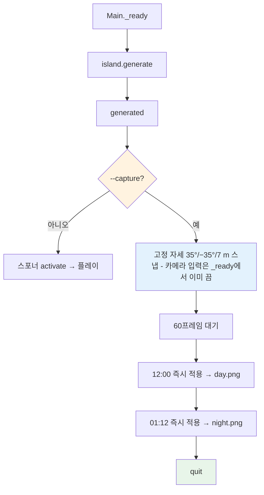

# 테스트 · 화면 캡처

## 개요

외부 플러그인(GUT 등) 없이 `SceneTree`를 상속한 러너가 `tests/test_*.gd`를 찾아 `test_`로 시작하는 메서드를 실행한다. 테스트 대상은 씬 트리와 Autoload 없이 동작하도록 설계했다(순수 static 함수, `tick()`, 주입 Callable). `-s`로 실행한 스크립트에서 Autoload 사용 가능 여부가 버전마다 애매하므로 [중간] 테스트는 Autoload를 참조하지 않는다. 화면 캡처는 렌더러가 필요하므로 헤드리스가 아닌 창 모드에서 `-- --capture`로 실행한다.

```
godot --headless --path . --import          # class_name 캐시 생성 (필수 선행)
godot --headless --path . -s tests/run_tests.gd   → 종료 코드 0 = 전부 통과, 1 = 실패 있음
godot --path . -- --capture                 → captures/day.png, captures/overview.png, captures/night.png 저장 후 종료
```

## 파일

| 경로 | 역할 |
|---|---|
| `tests/run_tests.gd` | `extends SceneTree` 러너 |
| `tests/test_case.gd` | `extends RefCounted` 기반 클래스(class_name 없음, 테스트 파일은 `extends "res://tests/test_case.gd"`) |
| `tests/test_inventory.gd`, `test_crafting.gd`, `test_vitals.gd`, `test_island.gd`, `test_spawner.gd` | 테스트 |
| `scripts/main.gd` | 캡처 모드 처리 |

## 러너

```gdscript
# tests/run_tests.gd
extends SceneTree
func _initialize() -> void
```

1. `DirAccess.get_files_at("res://tests")`에서 `test_*.gd`(러너·`test_case.gd` 제외)를 이름순으로.
2. 각 파일 `load(path).new()` → `get_method_list()`에서 `test_`로 시작하는 이름을 정렬해 순서대로 호출. 메서드 전에 `before_each()`가 있으면 호출.
3. 메서드마다 `PASS <파일>::<메서드>` 또는 `FAIL <파일>::<메서드> — <메시지>` 출력.
4. 마지막 줄 `RESULT passed=N failed=M`, `quit(1 if M > 0 else 0)`.
5. 테스트가 만든 Node는 테스트 안에서 `free()`한다(헤드리스 종료 시 누수 경고 방지).

`test_case.gd` 헬퍼: `assert_true(cond: bool, msg: String)`, `assert_eq(a, b, msg: String)`, `assert_near(a: float, b: float, eps: float, msg: String)`. 실패는 `failures: Array[String]`에 쌓고, 러너가 메서드 호출 뒤 비었는지 본다.

## 테스트 목록

아이템은 `load("res://data/items/<id>.tres")`로 직접 읽는다.

| 파일 | 메서드 | 검증 |
|---|---|---|
| test_inventory | `test_stack_overflow_splits` | wood 70 추가 → 슬롯0=64, 슬롯1=6, 반환 0 |
| | `test_full_inventory_returns_remainder` | 20칸을 도구로 채운 뒤 wood 5 추가 → 반환 5, 변화 없음 |
| | `test_weight_limit_partial` | max_weight 10, stone(2.0) 8 추가 → 5개 들어가고 반환 3 |
| | `test_remove_item` | wood 10 → remove 4 → count 6; remove 7 → false, count 6 그대로 |
| | `test_single_signal_per_call` | wood 130 추가 시 `inventory_updated` 1회 |
| test_crafting | `test_missing_ingredients_consumes_nothing` | wood 3, stone 1, 해금 상태 → 도끼 제작 false, wood 3·stone 1 유지 |
| | `test_success_consumes_exact` | wood 5, stone 4 → 도끼 → wood 2, stone 2, 도끼 1 |
| | `test_discovery_unlocks` | 빈 인벤 → 창 잠김; wood 1 추가 → `recipe_unlocked(&"wooden_spear")` 1회, 도끼는 여전히 잠김 |
| | `test_parse_rejects_unknown_item` | 알 수 없는 id 레시피는 결과에서 제외 |
| test_vitals | `test_sprint_drains_three_times_walk` | WALK tick(1) 감소량 × 3 ≈ SPRINT tick(1) 감소량 |
| | `test_starving_drains_health_gradually` | hunger 0, tick(1) → health 99 (즉사 아님), 100회 → died 1회 |
| | `test_eat_restores_hunger` | hunger 50 → eat({"hunger":15}) → 65, 상한 100 |
| test_island | `test_same_seed_same_heights` | `compute_heights` 두 번 → 배열 동일, 크기 181² |
| | `test_different_seed_differs` | 시드 다르면 다름 |
| | `test_edge_below_sea` | 중심에서 40 m 이상인 모든 정점 h < 0 |
| | `test_center_is_land` | 중심 h == 1.20(±0.01), `level_at(0,0) == 1` |
| | `test_level_distribution` | `h > 0.05`인 정점 기준: level 1·2·3이 모두 존재, 어떤 level도 육지의 50% 이하, 해변(level 0) 20~40%, level 2+3 ≥ 20% |
| | `test_cliff_heights` | 고원마다 `H − 부모 지면`(1단은 `BEACH_TOP`)이 0.6~1.2 m |
| | `test_outlines_smooth` | 모든 고원 윤곽: 이웃 정점 간격 ≤ 0.6 m, 연속 두 선분의 꺾임각 ≤ 15°(격자 계단이면 90°) |
| | `test_plateaus_nested` | level ≥ 2 고원의 모든 윤곽 정점이 부모 안쪽 ≥ 2.95 m(`radial_offset ≤ −2.95`), 2단끼리 윤곽 최소 거리 ≥ 3 m, 원점에서 모든 2단 윤곽까지 ≥ 4 m |
| | `test_land_single_component` | `h > 0.05` 격자를 4-이웃 flood fill → 성분 1개(작은 섬이 모래톱으로 연결) |
| | `test_ramp_counts_and_slopes` | 고원마다 경사로 ≥ 1, 본섬 1단 ≥ 3; 모든 경사로 `atan((h_top−h_foot)/L) ≤ 25°`, 1단 경사로 `h_foot ≥ 0.12` |
| | `test_nav_faces_respect_cliffs` | `_build_nav_faces()` 결과의 모든 삼각형: 세 정점 level이 같거나 무게중심이 경사로 `in_mouth` 안 |
| | `test_navmesh_connects_tiers` | 아래 "내비 연결 테스트" 절 |
| | `test_walls_in_mesh` | `_build_mesh_arrays()`에서 `abs(normal.y) < 0.3`인 정점 ≥ 1,000개, 그 y 범위 ≥ 0.6 m |
| | `test_placement_counts` | `_place_all(b)`: 소나무 ≥ 25, 야자수 ≥ 6, 바위 ≥ 15, 덤불 ≥ 10, `beach` ≥ 8, 풀 ≥ 500, 꽃 ≥ 120. 채집물 중 `wall_distance < 1.0` 또는 `in_any_ramp(…, 1.5)`인 것 0개 |
| test_spawner | `test_never_inside_safe_radius` | `land_projector` = 항등, 200회 호출 → 결과가 INF가 아니면 플레이어와 ≥ 12 m |
| | `test_bounded_retries` | `land_projector` = 항상 플레이어 위치 반환 → INF, `last_attempts == max_attempts` |
| harvest(test_crafting에 포함) | `test_tool_tier_yield` | `Harvestable.calc_yield(1, &"axe", 1, &"axe") == 3`, 맨손 1, 다른 도구 1 |

### test_island 준비와 내비 연결 테스트

`IslandLayout.build`와 격자 샘플은 GDScript에서 수백 ms가 걸린다 [중간]. 그래서 test_island는 `layout`·`heights`·`levels`(RefCounted·Packed 배열)를 멤버 변수에 한 번만 만들어 재사용한다(지연 초기화). 노드는 캐시하지 않는다. 상수는 `SEED 20261028`, `RES 181`, `CELL 0.5`, `RADIUS 28.0`이다.

```
_gen() -> IslandGenerator:                   # 노드가 필요한 테스트만 호출, 테스트 끝에서 free()
    g := IslandGenerator.new()               # 트리에 넣지 않음(@onready를 쓰지 않는 워커 쪽 함수만 호출)
    g.seed = SEED; g.resolution = RES; g.cell_size = CELL; g.radius = RADIUS
    g.layout = 캐시 layout; g.heights = 캐시 heights; g._levels = 캐시 levels
```

`test_navmesh_connects_tiers`는 다음 순서로 확인한다.

1. 소스를 만든다. `faces = g._build_nav_faces()`, `b = {}; g._place_all(b)`, `obstacles = IslandGenerator.obstacles_from(b)`, 그리고 게임과 같은 `add_faces` / `add_projected_obstruction`.
2. `navmesh = IslandGenerator.make_navmesh()`로 만들고 `NavigationServer3D.bake_from_source_geometry_data(navmesh, source)`로 **동기** 베이크한다(헤드리스에서도 내비 서버는 동작 [중간]).
3. 다각형 인접 그래프를 만든다. 정점 위치를 0.01 m 격자로 반올림하고, 두 다각형이 같은 위치 쌍의 변을 공유하면 인접이다. 베이크 결과는 하위 메시마다 정점이 중복될 수 있으므로 인덱스가 아니라 위치로 비교한다 [중간].
4. 시작 다각형은 `(0, H1, 0)`에 3D 거리가 가장 가까운 무게중심의 다각형(2 m 이내)이다. 여기서 BFS 한다.
5. 같은 성분에 있어야 하는 점(각각 가장 가까운 다각형, 2 m 이내 존재 필수):
   - 모든 경사로의 위쪽 점 `origin − dir·1.5`(y = h_top)와 아래쪽 점 `origin + dir·(L + 1.0)`(y = `height_at`)
   - 작은 섬 1단 중심(y = 1.20)

   하나라도 다른 성분이거나 다각형이 없으면 실패하고, 메시지에 해당 경사로/고원 인덱스를 적는다.

```
소스(격자 면 + 장애물) → 동기 베이크 → 위치 기준 인접 그래프 → 시작점 BFS → 경사로 위·아래·작은 섬 모두 도달?
                                                                          ↓ 아니오
                                                                      FAIL(인덱스)
```

## 캡처 모드 (`scripts/main.gd`)

`"--capture" in OS.get_cmdline_user_args()`일 때:

1. `Main._ready`에서 바로 `camera_rig.set_input_enabled(false)`(마우스 캡처 해제, 회전·줌·재캡처 입력 무시. CameraRig `_ready`가 먼저 캡처하므로 섬 생성 동안 커서가 잡혀 있지 않게 여기서 푼다). `island.generated`를 기다리고, 플레이어를 시작 지점에 둔 뒤 `camera_rig.set_pose(yaw, -35.0, 7.0)`(고정 자세, 보간 없이 스냅. yaw는 35°부터 ±20°씩 벌려 가며 피벗→카메라 선분에서 5 m 안에 소나무·야자수 수관이 없는 첫 값을 `main.gd`가 고른다 — 수관에는 충돌이 없어 SpringArm이 카메라를 밀어 주지 못해 잎 속 화면이 찍히는 것을 막는다. 고정 시드라 결과는 항상 같다), `player.face_direction(camera_rig.get_forward())`. 그 뒤 60 프레임 대기(내비·셰이더 컴파일 안정화, SpringArm 충돌 반영).
2. `WorldClock.running = false`, `WorldClock.set_time(0.25, true)`(12:00) → 10 프레임 → `get_viewport().get_texture().get_image().save_png("res://captures/day.png")`.
3. 같은 12:00에서 개요 촬영: 임시 `Camera3D`(fov 50, 위치 (0, 70, 45), 원점을 내려다봄, HUD 숨김) → 10 프레임 → `captures/overview.png`. fov를 50으로 맞추지 않으면(기본 75°) 먼 모서리에서 물 평면 끝이 보인다.
4. `WorldClock.set_time(0.80, true)`(01:12) → 10 프레임 → `captures/night.png`.
5. `print("CAPTURED ...")` 후 `get_tree().quit()`.

- `captures/`가 없으면 `DirAccess.make_dir_recursive_absolute(ProjectSettings.globalize_path("res://captures"))`. `captures/`에 `.gdignore`를 둬 임포트되지 않게 한다.
- 창 크기 1600×900(project.godot `display/window/size`). 플레이어 위치는 기본 시작 지점(고정 시드라 매번 같음), 카메라는 위의 고정 자세(yaw 35°, pitch −35°, 거리 7 m = 게임 시작 자세와 같음). 마우스를 움직여도 화면이 바뀌지 않는다. SpringArm 충돌 결과도 시드·자세가 같으므로 결정적이다.
- 헤드리스에서는 더미 렌더러라 이미지가 비므로 캡처 모드를 `--headless`로 실행하지 않는다.
- 캡처 모드에서는 적 스포너를 활성화하지 않는다(화면 비교를 결정적으로).

## main.tscn (참고: README의 전체 트리)

```gdscript
# scripts/main.gd
extends Node3D
func _ready() -> void   # WorldClock.reset(), register_lighting, hud.panels_changed → camera_rig.set_ui_open 연결, 캡처 모드면 camera_rig.set_input_enabled(false), island.generate()
func _on_island_generated(spawn_point: Vector3) -> void   # 플레이어 배치, camera_rig.set_pose(기본값)로 스냅, player.face_direction(camera_rig.get_forward()), HUD.bind, 스포너 activate(캡처 모드 제외)
func _on_player_died() -> void   # HUD.show_death → 2.5초 → reload_current_scene
```


