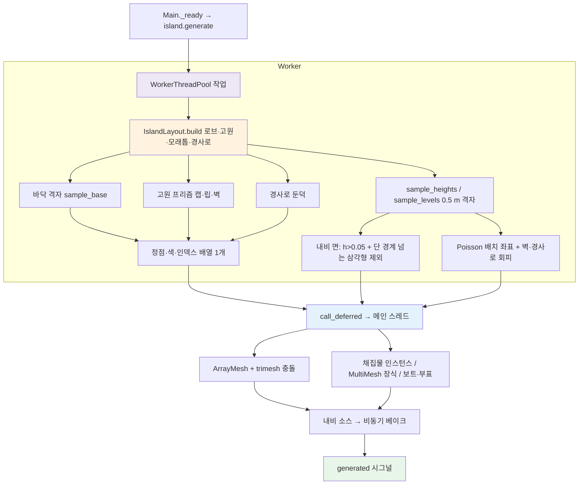
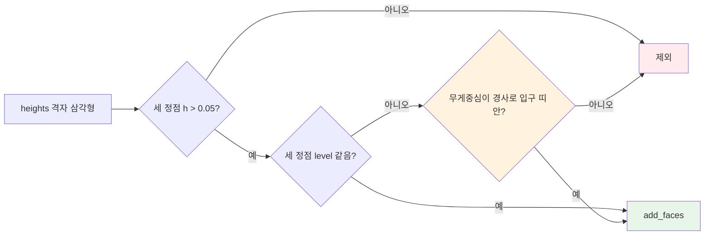

# 월드 · 섬 생성 (IslandGenerator)

## 개요

섬 지형은 에셋이 아니라 코드로 만든다. 목표 모습은 `assets/concept/reference.webp` 3번째 패널과 `assets/concept/concept_sheet.png`의 섬이다. 여러 로브가 붙은 두툼한 섬과 작은 섬 1개로 이루어지고, 모래 해변 고리 위에 평평한 풀 고원 3단이 주황 흙 절벽(0.8~0.9 m, 둥근 풀 립, 가로 지층 띠)으로 나뉜다. 단과 단 사이는 흙 경사로로 오간다.

이전 방식(노이즈 × 원형 감쇠 → 계단 양자화 → 블러)은 버린다. 이 방식에서는 0.5 m 격자 위의 1~2칸 폭 경사가 단 경계가 되어, 절벽이 생기지 않고 경계선이 격자 대각선을 따라 계단처럼 깨졌다. 큰 노이즈 한 덩어리가 한 단을 독차지해 육지의 약 60%가 한 높이였다.

새 방식은 **레이아웃(순수 데이터) → 세 가지 메시 조각 → 높이 격자(질의·내비용)** 순서다. 고원 윤곽은 격자와 무관한 해석적 곡선이라 계단 현상이 생길 수 없다.

- 레이아웃: `IslandLayout.build(seed, radius)`가 고원 다각형(중심 기준 극좌표 반지름 배열), 해변 폭, 모래톱, 경사로를 만든다. 순수 함수이고 노드에 접근하지 않는다.
- 메시: ① 바닥 격자(모래·해저만, 완만), ② 고원 프리즘(캡 + 립 + 수직 벽), ③ 경사로 둔덕. 하나의 `SurfaceTool`에 모은다.
- 높이 격자 `heights`: `layout.height_at`을 0.5 m 간격으로 샘플한 것이다. `get_height`·배치·내비 소스는 기존처럼 이 격자를 쓴다.

고정 시드로 레이아웃·격자·메시 배열·배치 좌표를 계산하는 일은 `WorkerThreadPool` 작업에서 하고, 노드 생성·메시·충돌·내비 등록은 메인 스레드에서 한다(기존 규칙 유지).



## 기법 선택

결정: **별 모양(star-shaped) 극좌표 고원 + 완만한 바닥 높이장 + 벽 압출 + 경사로 둔덕**.

| 후보 | 장점 | 탈락 이유 |
|---|---|---|
| 고해상도 높이맵 + smoothstep 절벽 + 경사별 버텍스 컬러 | 메시 하나, 구현 단순 | 70° 이상 벽을 계단 없이 그리려면 셀 ≤ 0.15 m(약 36만 정점)가 필요하다. 벽 한 면에 정점 행이 2~3개뿐이라 립·지층 띠를 버텍스 컬러로 표현할 수 없다. GDScript 생성 시간과 trimesh 충돌 비용도 크다 [중간] |
| SDF + 마칭 스퀘어 윤곽 추출 + 압출 | 임의 모양 | 안장점 처리, 선분 체인 연결, 구멍 있는 다각형 삼각분할(`Geometry2D.triangulate_polygon`은 구멍 미지원 [높음])이 필요하다. 코드량과 실패 지점이 늘어난다 |
| **극좌표 고원 (채택)** | 윤곽이 해석적 곡선이라 항상 단순 다각형이고, 중심 팬 삼각분할이 늘 유효하다. 안/밖 판정은 O(1)(각도 → 반지름 보간). 중첩(2단 ⊂ 1단)은 반지름을 줄이는 클램프로 강제할 수 있다 | 고원마다 중심에서 본 별 모양이어야 한다(갈고리·U자 불가). 대신 고원 여러 개와 로브로 다중 로브 모양을 만든다. 참조 섬은 이 범위 안이다 |

숨은 면(1단 캡 아래의 바닥 격자, 2단 아래의 1단 캡)은 그대로 둔다. 화면에 보이지 않고, 충돌에서는 플레이어가 닿을 수 없는 내부 면이다. 내비는 렌더 메시가 아니라 높이 격자를 쓰므로 숨은 면 때문에 언덕 속에 내비 섬이 생기지 않는다.

## 파일

| 경로 | 클래스 | 출처 |
|---|---|---|
| `scripts/world/island_generator.gd` | `IslandGenerator extends Node3D` | 수정. `populate_nature` 패턴은 `genre_survival_survival_patterns.gd`에서 인라인 |
| `scripts/world/island_layout.gd` | `IslandLayout extends RefCounted` | **신규**. 레이아웃 데이터·질의(순수) |
| `scripts/vendor/gdskills/island_noise.gd` | `IslandNoise extends RefCounted` | `procedural_generation_fast_noise_noise2d_master.gd` (원본은 `extends Node`, class_name 없음) |
| `scripts/vendor/gdskills/poisson_disk_sampler.gd` | `PoissonDiskSampler extends RefCounted` | `procedural_generation_poisson_disk_sampling_2d.gd` (원본은 `extends Node`, class_name 없음) |
| `scripts/world/harvestable.gd` | `Harvestable` | `docs/architecture/player-vitals-interaction.md` 참고 |
| `scenes/world/island.tscn` | — | 변경 없음 |
| `scenes/world/{pine_tree,palm_tree,rock,berry_bush}.tscn` | `Harvestable` 루트 | 변경 없음 |
| `scenes/world/{boat,buoy}.tscn` | 장식 | 변경 없음 |
| `shaders/water.gdshader`, `scenes/world/water.tscn` | — | 수정(수심 계산, `depth_fade`) |

### vendored 변경점

- `IslandNoise`: `extends Node` → `extends RefCounted` + `class_name IslandNoise`. `configure(seed, frequency)` 유지, 노이즈 타입을 `TYPE_SIMPLEX_SMOOTH`, `FRACTAL_FBM`, 옥타브 3으로. `generate_heightmap()`(Image, 정규화로 해상도 의존)는 쓰지 않고 `sample(x: float, z: float) -> float`(월드 좌표, -1..1)을 추가. 스레드마다 새 인스턴스를 만든다(공유 금지).
- `PoissonDiskSampler`: `extends RefCounted`, `static func generate_points(width: float, height: float, radius: float, seed: int, k: int = 30, max_points: int = 2000) -> Array[Vector2]`. 원본의 전체 점 비교(O(n²))를 **배경 격자(셀 크기 r/√2) 이웃 검사**로 바꾼다. RNG는 함수 안의 지역 `RandomNumberGenerator`(스레드 안전).

## IslandGenerator API

공개 API(`generated`, `get_height`, `is_land`, `beach_points`, `spawn_point`, `heights`, `compute_heights` 시그니처)는 바뀌지 않는다. 바뀌는 것은 기본값 세 개(`radius`, `resolution`, `SEA_FLOOR`)와 `layout` 추가, `terrace()` 삭제다(호출처 없음).

```gdscript
class_name IslandGenerator extends Node3D

signal generated(spawn_point: Vector3)

const SEA_FLOOR := IslandLayout.SEA_FLOOR     # -2.0 (이전 -1.6)

@export var seed: int = 20261028
@export var radius: float = 28.0              # 본섬 기준 반지름 R0 (이전 34 = 원형 감쇠 반지름)
@export var cell_size: float = 0.5
@export var resolution: int = 181             # 정점 수(한 변) → 90 m (이전 161 → 80 m)
@export var pine_scene: PackedScene
@export var palm_scene: PackedScene
@export var rock_scene: PackedScene
@export var bush_scene: PackedScene
@export var boat_scene: PackedScene
@export var buoy_scene: PackedScene

var heights: PackedFloat32Array               # 생성 후 읽기 전용 (= layout.sample_heights)
var layout: IslandLayout                      # 생성 후 읽기 전용 (신규)
var _levels: PackedByteArray                  # 내부: layout.sample_levels (내비 면 필터용)
var beach_points: Array[Vector3] = []         # 게 집/순찰 후보
var spawn_point: Vector3

func generate() -> void                       # 비동기. 완료 시 generated
func get_height(x: float, z: float) -> float  # heights 이중선형 보간, 격자 밖은 SEA_FLOOR
func is_land(x: float, z: float) -> bool      # get_height > 0.05

static func compute_heights(seed: int, resolution: int, cell_size: float, radius: float) -> PackedFloat32Array
    # = IslandLayout.build(seed, radius).sample_heights(resolution, cell_size)
static func make_navmesh() -> NavigationMesh                  # 신규: 베이크 파라미터 한 곳(테스트도 사용)
static func obstacles_from(b: Dictionary) -> Array[Dictionary] # 신규: 배치 변환 → 장애물 목록(씬 인스턴스와 무관)
```

- 격자를 80 m → 90 m로 넓힌 이유: 다중 로브 + 작은 섬이 원형보다 바깥으로 뻗는다(육지 최대 반지름 약 38.5 m). 반면 육지 면적은 기존과 비슷하게 유지한다(약 2,750 m², 기존 약 2,950 m²) [중간 — Python 원형(근사 노이즈)으로 측정].
- `_worker_build`가 쓰던 `_terrain_color`(높이·노멀 임계값 색)는 삭제한다. 색은 조각 종류로 정한다(메시 절).
- `_spawn_props`가 쌓던 `obstacles` 대신 `obstacles_from(b)`를 쓴다(씬이 null이어도 장애물은 같다 → 테스트에서 같은 베이크 재현).

## IslandLayout

```gdscript
class_name IslandLayout extends RefCounted
# 순수 데이터 + 질의. 노드·씬·전역 RNG 접근 금지. 워커 스레드에서 만들고 이후 읽기 전용.

const SEA_FLOOR := -2.0
const BEACH_TOP := 0.40                       # 1단 벽 발치의 모래 높이
const LEVEL_HEIGHT: Array[float] = [0.40, 1.20, 2.10, 2.90]   # [level] 캡 높이. 0 = 해변 꼭대기
const LIP_INSET := 0.20
const RAMP_WIDTH := 3.0
const RAMP_LENGTH := 2.4
const RAMP_SIDE_SLOPE_DEG := 30.0

class Plateau extends RefCounted:
    var level: int                            # 1~3
    var parent: int                           # plateaus 인덱스. 1단은 -1
    var center: Vector2                       # (x, z)
    var radii: PackedFloat32Array             # radii[i] = 각도 i·TAU/N 방향 반지름 (각도 = atan2(z, x))
    var beach: PackedFloat32Array             # 1단만: 같은 각도의 해변 폭 B. 그 외 빈 배열
    var outline: PackedVector2Array           # center + radii[i]·(cos, sin)
    var normals: PackedVector2Array           # 바깥 단위 법선: d = outline[i+1] − outline[i−1], n = Vector2(d.y, −d.x).normalized() (θ 증가 순서일 때 바깥)
    func radial_offset(x: float, z: float) -> float   # ρ − r(θ), r은 인접 두 샘플 선형 보간. 음수 = 안
    func beach_width(x: float, z: float) -> float

class Ramp extends RefCounted:
    var plateau: int
    var origin: Vector2                       # 벽선 위 입구 중심
    var dir: Vector2                          # 바깥 법선 n (단위)
    var h_top: float
    var h_foot: float
    func local(x: float, z: float) -> Vector2          # (s, t): s = (p−origin)·n, t = (p−origin)·(−n.y, n.x)
    func height_at(x: float, z: float) -> float        # 발자국 밖이면 -INF
    func in_footprint(x: float, z: float, margin: float) -> bool
    func in_mouth(x: float, z: float) -> bool

var plateaus: Array[Plateau]
var ramps: Array[Ramp]
var spit_a: Vector2                           # 모래톱 선분 양 끝
var spit_b: Vector2

static func build(seed: int, radius: float) -> IslandLayout
func base_height(x: float, z: float) -> float      # 모래·해저만(고원·경사로 제외). 바닥 격자 메시용
func height_at(x: float, z: float) -> float        # max(base_height, 포함하는 고원 캡 높이, 경사로 height_at)
func level_at(x: float, z: float) -> int           # 점을 포함하는 고원 중 최대 level, 없으면 0 (경사로 무시)
func wall_distance(x: float, z: float) -> float    # 모든 고원의 |radial_offset| 최솟값 (반지름 방향 근사)
func in_any_ramp(x: float, z: float, margin: float) -> bool
func sample_heights(resolution: int, cell_size: float) -> PackedFloat32Array
func sample_levels(resolution: int, cell_size: float) -> PackedByteArray
func sample_base(resolution: int, cell_size: float) -> PackedFloat32Array
```

격자 좌표 규칙은 기존과 같다. 중심이 원점이고 `x = i·cell_size − half`, `half = (resolution−1)·cell_size/2`다.

성능: 격자 32,761점마다 `height_at`을 부르므로, 고원·경사로마다 경계원(중심, 최대 반지름 + 여유) 밖이면 즉시 건너뛴다. 이렇게 하면 워커에서 1초 미만이다 [중간].

### 생성 순서와 난수

`build` 안에서 지역 `RandomNumberGenerator`(`rng.seed = seed`) 하나와 `IslandNoise` 하나(`configure(seed, 0.04)`)만 쓴다. 호출 순서가 결과를 정하므로 아래 순서를 지킨다.

1. 로브 6개를 표 순서대로 지터한다(로브마다 `randf_range(-6, 6)`°, `randf_range(0.85, 1.15)` 배).
2. 본섬 1단 → 작은 섬 1단 → 모래톱 → 2단 a·b·c(각각 `rng.randf()·TAU`로 φ) → 3단 순으로 만든다.
3. 2단·3단을 부모 안으로 클램프한다.
4. 경사로를 고원 순서대로 고른다(각 고원 `rng.randf()·TAU`로 시작각).

각도 노이즈 `n_k(θ) = noise.sample(15·cosθ + 200·k, 15·sinθ)`는 반지름 15 m 원 위를 샘플해 주기성이 있고, 한 바퀴에 약 4번 출렁인다. 채널 k: 0 본섬 윤곽, 1 해변 폭, 2 작은 섬, 3~5 2단 a·b·c, 6 3단.

```
로브 지터 → 본섬 1단 → 작은 섬 → 모래톱 → 2단 a·b·c → 3단 → 클램프 → 경사로 선택
```

### 본섬과 1단

`bump(Δ, w) = 0.5·(1 + cos(π·clamp(Δ/w, −1, 1)))`, Δ는 −π..π로 감은 각도 차다.

```
r_L(θ) = R0 · (1 + Σ amp_i·bump(θ − θ_i, w_i)) · (1 + 0.04·n_0(θ))     # 물가선 반지름
B(θ)   = 5.0 + 1.2·n_1(θ)                                               # 해변 폭 (원형 측정 4.0~6.1 m)
r_1(θ) = r_L(θ) − B(θ)                                                  # 1단 벽선
```

| 로브 | θ_i (°) | amp_i | 반폭 w_i (°) | 역할 |
|---|---|---|---|---|
| 1 | 10 | +0.28 | 34 | 동쪽 큰 로브(2단 a, 3단) |
| 2 | 90 | +0.14 | 36 | 북쪽 로브(2단 c) |
| 3 | 150 | −0.26 | 26 | 만(灣). 작은 섬이 이 앞에 놓인다 |
| 4 | 205 | +0.26 | 34 | 남서 큰 로브(2단 b) |
| 5 | 270 | +0.12 | 40 | 남쪽 완만한 로브 |
| 6 | 325 | −0.22 | 22 | 작은 만 |

본섬 1단: `level 1`, `center (0,0)`, 샘플 수 `N = clampi(int(TAU·R_nominal/0.35), 64, 512)`(본섬 R_nominal = R0 → 502).

### 작은 섬과 모래톱

- 작은 섬 1단: 중심은 로브 3의 지터 후 각도 방향 31.5 m. `r_L,i(θ) = 7.0·(1 + 0.08·n_2(θ))`, 해변 폭 2.3 m(상수), `r_1 = r_L,i − 2.3`. 본섬과 사이에 폭 약 3~4 m의 물길이 보인다.
- 모래톱: `dir` = 작은 섬 중심 방향 단위벡터, `spit_a = dir·(본섬 r_1(θ_dir) + 1.0)`, `spit_b = 작은섬중심 − dir·(작은섬 r_1(θ_dir+π) + 1.0)`. 높이는 아래 모래 단면을 `u = 선분거리 − 1.0`, 꼭대기 0.20, 폭 1.5로 적용한다. 마른 폭은 약 4 m이고, 내비 침식 후 약 3 m가 남는다.

### 2단 · 3단

| 고원 | level | 부모 | 중심 | R | 모양 |
|---|---|---|---|---|---|
| 2단 a | 2 | 본섬 1단 | 각도 15°, 거리 16.0 | 10.5 | `r = R·(1 + 0.10·sin(2θ+φ) + 0.05·n_k(θ))` |
| 2단 b | 2 | 본섬 1단 | 각도 210°, 거리 16.5 | 10.5 | 같음 |
| 2단 c | 2 | 본섬 1단 | 각도 100°, 거리 17.0 | 8.5 | 같음 |
| 3단 | 3 | 2단 a | 2단 a 중심과 같음 | 4.5 | 같음 |

**클램프**는 각 정점 p_i에 대해 `u = parent.radial_offset(p_i)`를 구하고, `u > −ledge`이면 `r_i −= u + ledge`로 줄이는 일을 4회 반복하는 것이다. 순서는 ledge 3.5로 클램프 → 원형 스무딩 3회(`0.25·r[i−1] + 0.5·r[i] + 0.25·r[i+1]`) → ledge 3.0으로 다시 클램프다. 결과적으로 1단 띠(턱)는 어디서나 3 m 이상 남고, 클램프된 구간에서는 2단 윤곽이 1단 윤곽을 3 m 간격으로 따라가 계단식 단이 겹쳐 보인다(컨셉 시트와 같은 인상).

원형 측정값(시드 5개): 2단끼리 최소 간격 4.4 m 이상, 원점(시작 지점)에서 2단 벽까지 4.7 m 이상, 1단 연결 성분은 본섬·작은 섬 2개 [중간].

### 높이 단면

`base_height(x, z)`는 아래 세 값의 최댓값이고, 아래쪽은 `SEA_FLOOR`로 자른다.

- 본섬: `sand(u = 본섬1단.radial_offset, top = 0.40, width = B(θ))`
- 작은 섬: `sand(u, 0.40, 2.3)`
- 모래톱: `sand(선분거리 − 1.0, 0.20, 1.5)`

```
sand(u, top, width):
  u ≤ 0            → top                                   # 고원 아래(숨음)
  0 < u ≤ width    → top · (1 − u/width)                   # 마른 모래, 물가선 u = width
  v = u − width > 0 → 선형 보간 (v, h): (0, 0) (0.8, −0.40) (4.0, −0.80) (7.0, −2.0), 이후 −2.0
```

물속 단면은 물 색을 위해 정했다(물 절). 물가선에서 0.8 m 동안 급하게 −0.4까지 내려가 거품 띠가 약 0.7 m로 좁다. 그다음 3.2 m는 얕은 대륙붕(−0.4~−0.8)이라 밝은 청록 고리가 되고, 이후 해저로 떨어진다.

`height_at = max(base_height, 포함하는 고원 중 최고 캡 높이, 각 경사로 height_at)`이다. 결과 높이는 해저 −2.0, 해변 0~0.40, 1단 1.20, 2단 2.10, 3단 2.90이고, 절벽 높이는 1단 0.80, 2단 0.90, 3단 0.80이다.

## 경사로

단마다 오르내릴 수 있게, 벽 바깥에 흙 둔덕을 붙인다. 가운데 띠(폭 3.0 m)는 기울기 25° 이하의 길이고(2·3단 20.6°, 해변 경사로 최대 24.2° = `atan((1.20−0.12)/2.4)`), 양옆은 30° 비탈이다. 30°는 내비(`agent_max_slope 40`)와 `CharacterBody3D`(`floor_max_angle` 기본 45°) 모두에서 걸을 수 있는 경사다. 그래서 둔덕 어디를 밟아도 물리와 내비가 일치한다. 둔덕 옆면을 수직 벽으로 만들면, 발치 쪽의 낮은 옆벽(0.1~0.4 m)을 내비는 넘을 수 있다고 보고 물리(캡슐 r 0.3, 게 박스)는 막아서 적이 끼게 된다.

### 개수와 치수

| 고원 | 개수 | h_top | h_foot |
|---|---|---|---|
| 본섬 1단 | 4 | 1.20 | `base_height(발치)` |
| 작은 섬 1단 | 1 | 1.20 | `base_height(발치)` (모래톱 쪽이 선택됨) |
| 2단 a / b / c | 2 / 2 / 1 | 2.10 | 1.20 |
| 3단 | 1 | 2.90 | 2.10 |

`L = RAMP_LENGTH 2.4`, `W = RAMP_WIDTH 3.0`, `side_run = (h_top − h_foot)/tan(30°)`.

### 높이 함수 (로컬 s, t)

```
발자국: −1.0 ≤ s ≤ L,  |t| ≤ W/2 + side_run   (밖이면 −INF)
s ≥ 0 : axis = lerp(h_top, h_foot, s/L)
s < 0 : axis = h_top − 0.03                     # 벽 안쪽으로 1 m 파고들어 볼록한 벽과의 틈을 메움. 캡보다 3 cm 아래라 겹쳐도 숨음
h = axis − max(0, |t| − W/2)·tan(30°)
```

- 입구 띠 `in_mouth`: `−1.0 ≤ s ≤ 0.75` 이고 `|t| ≤ W/2 − 0.2`.
- 발치(s = L)에서 `h = h_foot` = 아래 단 지면이라 이음매가 없다. 해변 경사로는 `h_foot`이 바깥으로 갈수록 낮아지는 모래와 맞닿는다.

### 선택 알고리즘

고원 순서(본섬 1단, 작은 섬, 2단 a, b, c, 3단)대로 처리한다. 각 고원에서:

1. 후보는 윤곽 샘플을 10° 간격(36개)으로 뽑는다. 후보 i의 `origin = outline[i]`, `n = normals[i]`, `t = (−n.y, n.x)`다.
2. 유효 조건(모두 만족해야 함):
   - a. 발치 `f = origin + n·L`과 `f2 = origin + n·(L+1.0)`의 `level_at`이 부모 단(1단이면 0)과 같다.
   - b. 1단이면 `base_height(f) ≥ 0.12`, `base_height(f2) > 0.05`(발치가 마른 모래).
   - c. 발자국 네 귀퉁이 `origin ± t·(W/2+side_run)`, `f ± t·(W/2+side_run)`를 n 방향으로 0.3 m 민 점의 `level_at`이 부모 단과 같다(다른 고원과 겹치지 않음).
   - d. 이미 고른 모든 경사로(다른 고원 포함)의 origin·발치와 6 m 이상 떨어져 있다.
3. 시작각 φ0 = `rng.randf()·TAU`, 선호각 `φ0 + k·TAU/개수`(k = 0..개수−1). 선호각마다 유효 후보 중 각도 차가 가장 작고, 같은 고원에서 이미 고른 것과 `0.5·TAU/개수` 이상 떨어진 것을 고른다.
4. 개수를 못 채우면 `push_warning`하고 진행한다(테스트가 잡는다).

```
후보 36개 → 유효 조건 a~d 필터 → 선호각에 가까운 순 선택 → Ramp 생성(h_top, h_foot)
                  ↓ 유효 후보 부족
              push_warning (테스트 실패로 드러남)
```

원형 측정에서 유효 후보 수는 본섬 17~33개, 2단 24~34개, 작은 섬 2~4개였다(모래톱 쪽) [중간].

## 메시

한 `SurfaceTool`(PRIMITIVE_TRIANGLES, `set_color` + `add_vertex` + `add_index`)에 세 조각을 넣고 `generate_normals()` 후 `commit_to_arrays()`. 머티리얼은 기존과 같다: `StandardMaterial3D`, `vertex_color_use_as_albedo = true`, roughness 0.9, metallic 0, specular 0.3. 삼각형 감김은 기존 규칙(위에서 볼 때 시계 방향 = 앞면)이고, 벽은 바깥에서 볼 때 시계 방향이다. 감김이 틀리면 뒷면 컬링으로 벽이 사라지니 캡처로 확인한다.

### ① 바닥 격자

- 181×181 정점, 높이 = `sample_base`(고원·경사로 제외), 색은 전부 모래 `#E4C799`(물속은 물이 불투명이라 보이지 않는다).
- 삼각형 생략 규칙(정점은 그대로 두고 인덱스만 뺀다):
  - 세 정점 모두 `level ≥ 1`이고 `wall_distance ≥ 0.6`인 삼각형(캡 아래 숨음)
  - 세 정점 모두 `h ≤ SEA_FLOOR + 0.01`인 삼각형(평평한 해저. 그 너머도 물 셰이더에서 같은 깊은색)

### ② 고원 프리즘

윤곽 정점 i마다 `p = outline[i]`, `n = normals[i]`로 링을 쌓는다. 위치는 `p + n·d`, 높이는 `H + dy`(H = 캡 높이, G = 부모 지면 높이: 1단 0.40, 2단 1.20, 3단 2.10)이다. 이웃 링끼리 사각형(삼각형 2개)으로 잇고, 마지막 정점은 첫 정점과 잇는다.

| 링 | d (m) | dy (m) | 색 |
|---|---|---|---|
| C0 캡 가장자리 | −0.20 | 0 | 캡 색 |
| C1 | −0.10 | −0.03 | 캡 색 |
| C2 | −0.02 | −0.09 | 캡 색 |
| C3 립 최외곽 | +0.05 | −0.17 | 캡 색 |
| C4 립 밑면 | +0.03 | −0.24 | 잎 진함 `#2F8F57` |
| W0 흙 시작 (C4와 같은 위치, 별도 정점) | +0.03 | −0.24 | 흙 `#C36F46` |
| W1..Wk 지층 | 0.04·sin(π·j/(k+1)) (불룩) | −0.24 ~ (G−H+0.10) 균등 | 흙 / 흙 띠 `#B4643F` 교대(W1 = 흙 띠) |
| F0 발치 | +0.10 | G − H + 0.03 | 흙 진함 `#985033` |
| F1 묻힘 | +0.14 | G − H − 0.25 | 흙 진함 `#985033` |

- 지층 링 수 `k = maxi(2, roundi((H − G − 0.34)/0.16))`. 1단은 3개, 2단은 4개다.
- 캡 색: 1단 풀 `#5DB85E`, 2단·3단 풀 밝음 `#79C46A`.
- 캡: 중심점 `center`(높이 H, 캡 색)와 C0 링을 팬으로 잇는다. 별 모양이므로 팬이 항상 유효하다. 2단 아래에 남는 1단 캡은 숨은 면이다.
- 샘플 수 `N`(본섬 502, 작은 섬 125, 2단 약 150~185, 3단 80)는 윤곽 간격 약 0.35 m에 해당한다. 위에서 볼 때 윤곽이 매끈하다.
- C4/W0처럼 위치가 같고 색이 다른 링 때문에 립 아래에 법선 꺾임이 생길 수 있다. 립이 튀어나온 그림자로 읽히므로 허용한다.

```
캡(팬) → C0~C3 둥근 립(풀) → C4 립 밑면(진한 잎) ║ W0 흙 → 지층 띠 교대 → F0 발치(진흙) → F1 모래 속
```

### 경사로 입구의 벽

경사로 입구 구간(윤곽 정점이 경사로 로컬 좌표에서 `|s| ≤ 1.0`이고 `|t| ≤ W/2 + 0.1`)에서는 고원 프리즘의 립·벽 띠를 만들지 않는다(캡 팬은 유지). 경사로 둔덕이 그 자리를 대신한다. 벽을 그대로 두면 립의 풀 조각이 둔덕의 흙 비탈을 뚫고 나온다.

### ③ 경사로 둔덕

- 경사로마다 로컬 격자를 만든다. s는 −1.0 ~ L, t는 ±(W/2 + side_run), 간격 0.3 m다.
- 정점 높이 `y = max(ramp.height_at, ground − 0.05)`. 여기서 `ground` = 경사로를 뺀 지면(`max(base_height, 고원 캡)`)이다. 지면보다 낮은 부분은 5 cm 아래로 묻힌다.
- 간격 0.15 m. 색(길이 풀로 읽히게): 길(`|t| ≤ W/2`)은 s를 따라 **위 단 캡 색 → 아래 단 지면 색**(1단 경사로는 풀 → 모래, 2·3단은 풀 → 아래 단 풀)으로 smoothstep 섞고, 양옆 비탈도 같은 풀 → 아래 지면 색이고, 절벽 흙색 `#C36F46`은 벽 바로 옆(s ≈ 0~1.2 m)의 비탈에만 섞는다. 비탈 바깥 0.8 m는 아래 지면 색으로 되돌리고, 바깥 0.6 m는 높이를 5 cm 더 묻어 지면과 만나는 들쭉날쭉한 교선을 감춘다.

### 예산

| 조각 | 정점 | 삼각형(생략 후) |
|---|---|---|
| 바닥 격자 | 32,761 | 약 20,000 |
| 고원 6개 | 약 13,500 | 약 27,000 |
| 경사로 11개 | 약 3,300 | 약 6,000 |
| 합계 | 약 49,500 | 약 53,000 (기존 51,200과 비슷) |

충돌은 기존과 같다: `StaticBody3D`(레이어 1) + `CollisionShape3D`에 `mesh.create_trimesh_shape()`.

## 배치 (Poisson)

`PoissonDiskSampler`로 x·z 평면(90×90, 원점 보정)에 점을 뽑고, 점마다 `get_height`·경사·**벽 거리·경사로**로 걸러낸다. 시작 지점 반경 5 m 안과 이미 배치된 점 1.5 m 안은 제외한다(채집물만). 처리 순서는 표 순서다.

| 종류 | 반경 r | 조건 | 벽 거리 ≥ | 경사로 제외 여유 | 최대 | 원형 측정 | 시드 오프셋 |
|---|---|---|---|---|---|---|---|
| 소나무 | 4.5 | h ≥ 0.8, 경사 노멀 y ≥ 0.92 | 1.0 | 1.5 | 30 | 30 | +1 |
| 야자수 | 5.0 | 0.15 ≤ h ≤ 0.5 | 1.0 | 1.5 | 10 | 7~10 | +2 |
| 바위 | 6.0 | h ≥ 0.2 | 1.0 | 1.5 | 20 | 20 | +3 |
| 베리 덤불 | 7.0 | h ≥ 0.8 | 1.0 | 1.5 | 12 | 12 | +4 |
| 게 해변 지점 `beach_points` | 6.0 | 0.1 ≤ h ≤ 0.5 | 0.8 | 0 | 12 | 11~12 | +5 |
| 풀 장식 (MultiMesh) | 1.2 | h ≥ 0.5, 노멀 y ≥ 0.9 | 0.3 | 0 | 600 | 600 | +6 |
| 꽃 장식 (MultiMesh) | 2.5 | h ≥ 0.5 | 0.3 | 0 | 150 | 150 | +7 |

- 벽 거리 = `layout.wall_distance(x, z)`. 경사로 제외 = `layout.in_any_ramp(x, z, 여유)`이면 버린다. 여유 0은 발자국 자체만 뺀다는 뜻이다. 채집물 여유 1.5 m는 장애물 반지름 최대 0.7 + 에이전트 반지름 0.5보다 크므로, 장애물이 경사로를 막을 수 없다.
- 높이 조건 임계값(0.8, 0.15~0.5 등)은 기존 그대로다. 새 높이(해변 ≤ 0.40, 1단 1.20)와 맞는다.
- 각 배치물의 y 회전은 지역 RNG로 0~2π, 스케일 0.9~1.15.
- 채집물은 `Props`(Node3D) 아래에 개별 씬으로 넣는다(수가 적고 상호작용이 있으므로).
- 풀·꽃은 `MultiMeshInstance3D` 2개. `MultiMesh.use_colors = true`, 메시는 코드로 만든다(풀: 높이 0.25 m 원뿔 3개를 합친 `ArrayMesh`, 꽃: 반지름 0.07 m `SphereMesh` + 인스턴스 색 `#F6F1E4`/`#F2A0B8`/`#FDE254` 중 무작위). 그림자 끔.
- 보트 1척: `beach_points`를 순서대로 보며, 원점→점 방향으로 3 m 바깥이 `get_height < −0.3`인 첫 점을 쓴다(작은 섬의 본섬 쪽 해변처럼 바깥이 육지인 점은 건너뜀). y = 0, 섬을 향하게 둔다. 없으면 보트를 생략한다.
- 부표 3개: 반지름 **43~46 m** 원 위 120° 간격(이전 38~42 m는 작은 섬(최대 약 38.5 m)과 겹칠 수 있음). y = 0, 0.3 m 진폭 2.5초 주기 상하 Tween.

## 내비게이션

```
Island
└─ NavRegion (NavigationRegion3D)   # navigation_mesh는 코드에서 설정
```

- `make_navmesh()`: `cell_size 0.25`, `cell_height 0.25`(맵 기본값과 일치), `agent_radius 0.5`, `agent_height 1.0`, `agent_max_climb 0.5`, `agent_max_slope 40`(기존과 같음).
- 소스: `heights` 격자 삼각형 중 아래 두 조건을 모두 만족하는 것만 `add_faces()`한다.
  1. 세 정점 모두 h > 0.05(해수면 위, 기존 규칙)
  2. 세 정점의 `level`(`sample_levels`)이 모두 같거나, 무게중심이 어떤 경사로의 `in_mouth` 안
- 조건 2가 절벽을 막는다. 단 경계를 가로지르는 삼각형을 빼면 위·아래 사이에 0.5 m 틈이 생겨 Recast가 잇지 않는다(climb 값과 무관). 경사로 입구에서만 잇는다. 입구 띠 폭 2.6 m에서 침식 0.5 m씩을 빼면 통로 약 1.6 m가 남는다. 입구 양옆, 즉 둔덕 비탈 위로 벽이 드러난 곳은 물리적으로 막히고 내비도 끊겨 있어 서로 일치한다.
- 렌더 메시 대신 높이 격자를 쓰는 이유: 숨은 면(캡 아래)이 없어 언덕 속 가짜 내비 섬이 생기지 않는다. 이 때문에 `map_get_closest_point`(스포너)가 언덕 안을 고를 일이 없다. 격자의 절벽 근처 오차(≤ 0.5 m)는 침식 0.5 m 안에 들어간다.
- 장애물: `obstacles_from(b)`가 소나무·야자수·바위·덤불 변환마다 `{pos, radius}`(0.5/0.4/0.7/0.5 m)를 만든다. 각각 `add_projected_obstruction()`(정사각 근사 꼭짓점, 높이 2 m, carve true).
- 베이크: `NavigationServer3D.bake_from_source_geometry_data_async(navmesh, source, callback)` → 콜백에서 `NavRegion.navigation_mesh = navmesh` → 맵 동기화 대기(기존 코드 유지) → `generated.emit(spawn_point)`.
- MVP에서 런타임 재베이크는 없다(나무가 베여도 장애물 유지).
- 플레이어는 절벽에서 뛰어내릴 수 있다(중력 낙하, 낙하 피해 없음). 올라가는 길은 경사로뿐이다. 적은 내비가 이어진 곳만 다니므로 뛰어내리지 않는다.



## 물

- `Water`(MeshInstance3D, `PlaneMesh` 400×400, subdivide 0), y = 0, `shaders/water.gdshader`.
- 셰이더: `hint_depth_texture`로 수심을 구해 얕은색→깊은색을 보간하고, 해안선 거품 띠와 노이즈 노멀 2장 스크롤(속도 0.02), roughness 0.15를 넣는다. 깊이 텍스처를 읽으므로 투명 패스로 그려진다 [중간]. 값은 style-guide의 "물" 절.
- `uniform`: `shallow_color`, `deep_color`, `foam_color`, `depth_fade`(**1.2**, 이전 1.8), `foam_width`(0.35). 낮/밤 색은 `WorldClock`이 Tween한다(`worldclock-ui.md`).

### 수심 계산 수정 (사각형 해저 윤곽 버그)

원인: 이전 수심은 뷰 공간 z 차이라 카메라 각도에 따라 실제 수심의 약 0.7~1.75배로 변했다. 게다가 해저 −1.6이 `depth_fade 1.8`보다 얕았다. 그래서 해저 격자가 깊은색까지 포화하지 못했고, 격자가 끝나는 80 m 사각형 경계(그 너머는 기하 없음 → 완전 깊은색)가 밝기 차로 보였다.

수정 두 가지:

1. 수심을 **수직 거리**(m)로 바꾼다. 깊이 버퍼에서 바닥 점의 월드 좌표를 복원해 수면 y와 뺀다. 이제 `depth_fade`·`foam_width`가 카메라 각도와 무관한 실제 미터이고, 고리 폭이 화면마다 같다.

   ```glsl
   float depth = textureLod(depth_tex, SCREEN_UV, 0.0).r;
   vec4 view = INV_PROJECTION_MATRIX * vec4(SCREEN_UV * 2.0 - 1.0, depth, 1.0);
   view.xyz /= view.w;
   vec3 floor_world = (INV_VIEW_MATRIX * vec4(view.xyz, 1.0)).xyz;
   float water_depth = max(world_pos.y - floor_world.y, 0.0);   // world_pos = 기존 varying(수면 월드 좌표)
   ```

   기하가 없는 픽셀(격자 밖)은 깊이가 원평면(far 200)이라 수직 깊이가 매우 커서 깊은색이 된다 [중간 — Godot 4.3+ reverse-Z, 원근 투영 기준].

2. 불변식 **`depth_fade ≤ |SEA_FLOOR| − 0.5`**(1.2 ≤ 1.5). 평평한 해저에서 이미 깊은색으로 포화하므로, 해저 격자와 그 너머가 같은 색이 되어 사각형이 사라진다. `SEA_FLOOR`나 `depth_fade`를 바꿀 때 이 식을 지킨다.

물가에서 보이는 띠(수직 수심 기준): 거품은 수심 0~0.35, 물가선에서 약 0.7 m 폭. 얕은 청록은 0.35~1.2, 물가선에서 약 0.7~5 m. 그 바깥은 깊은색이다.

## 이동 경계

지형 충돌은 해저까지 이어지므로 플레이어가 바다로 걸어 들어갈 수 있다. `Player`는 이동 전 목표 위치의 `island.get_height(x, z) < -0.3`이면 수평 이동을 막는다(`player-vitals-interaction.md`, 변경 없음). 새 단면에서 −0.3은 물가선에서 약 0.6 m 바깥, 즉 거품 띠 안이다. 적은 내비가 육지에만 있으므로 별도 처리 없음.

## island.tscn 노드 트리

```
Island (Node3D, island_generator.gd)
├─ Terrain (MeshInstance3D)
│  └─ TerrainBody (StaticBody3D, layer 1)
│     └─ CollisionShape3D
├─ NavRegion (NavigationRegion3D)
├─ Props (Node3D)          # Harvestable 인스턴스
├─ Grass (MultiMeshInstance3D)
├─ Flowers (MultiMeshInstance3D)
└─ Decor (Node3D)          # boat, buoy ×3
```

## 검증

자동 테스트 목록과 기준은 `testing-capture.md`의 test_island 행에 있다(단 수, 단 비율, 절벽 높이, 윤곽 매끈함, 중첩, 경사로 수, 내비 연결, 배치 수).

눈으로 보는 기준(QA, `captures/day.png` + 개요 화면):

- 위에서 보면 원형이 아니라 로브 4개 이상이 보이고, 작은 섬 1개가 모래톱으로 이어진다.
- 풀 고원 3단이 색과 벽으로 구분되고, 벽은 주황 흙에 가로 띠가 있으며 위 가장자리가 둥근 풀 립이다.
- 고원 경계에 격자 계단(톱니)이 없다.
- 물가에 얇은 흰 거품, 그 바깥에 밝은 청록 고리가 있다. 격자 경계 사각형이 보이지 않는다(pitch −70°에서도).

**미결정 — 개요 캡처**: 지금 캡처는 시작 지점 시점(앞 약 22 m)뿐이라 섬 전체 모양을 자동으로 남기지 않는다.

- (a) 지금처럼 QA가 임시로 개요를 찍는다.
- (b) 캡처 모드에 `captures/overview.png`(카메라 (0, 70, 45)에서 원점을 내려다봄, 12:00)를 추가한다.

추천 (b). 이번 변경의 합격 기준이 섬 전체 모양이고, 다음 튜닝 때 비교 기준이 된다.
