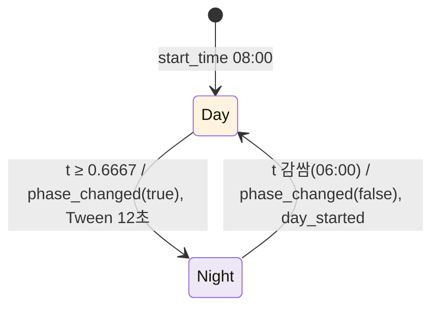
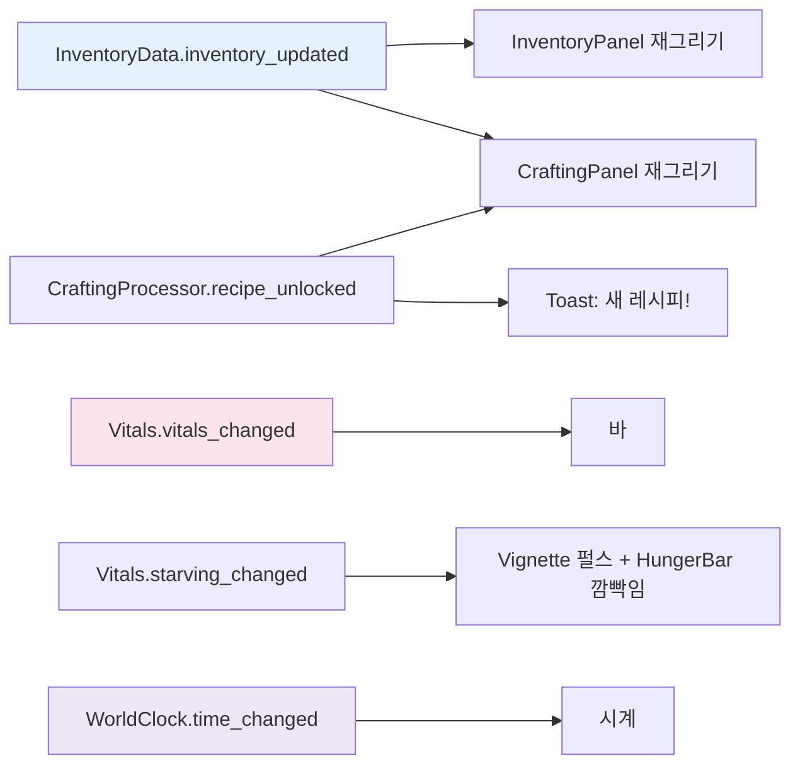

# WorldClock · 조명 · UI

## 개요

시간은 Autoload `WorldClock`이 소유한다. UI는 시간을 계산하지 않고 시그널만 받는다. 조명·하늘·물 색 보간도 `WorldClock`이 하되, 씬 노드는 `Main`이 `register_lighting()`으로 넘겨준다(Autoload가 씬 경로를 하드코딩하지 않게). UI는 HUD·인벤토리·제작 패널 세 장이고, 슬롯 위젯 하나를 인벤토리와 제작 패널이 함께 쓴다.

```
WorldClock._process → time_changed(4Hz) → HUD 시계
                    → phase_changed(is_night) → 조명 Tween 12초, EnemySpawner
Player/Vitals 시그널 → HUD 바·경고·프롬프트
InventoryData.inventory_updated → InventoryPanel 갱신
CraftingProcessor.recipe_unlocked / inventory_updated → CraftingPanel 갱신
HUD 패널 열림/닫힘 → panels_changed → CameraRig.set_ui_open(마우스 모드)
```

## WorldClock (Autoload, `autoload/world_clock.gd`, class_name 없음)

```gdscript
extends Node

signal time_changed(time_of_day: float, day: int)   # 최대 4Hz
signal phase_changed(is_night: bool)
signal day_started(day: int)

@export var day_length_sec: float = 360.0
@export var night_start: float = 0.6667            # 22:00
@export var start_time: float = 0.0833             # 08:00
@export var transition_sec: float = 12.0
@export var time_scale: float = 1.0

var time_of_day: float                             # 0..1, 0 = 06:00
var day: int = 1
var is_night: bool = false
var running: bool = true

func reset() -> void                               # 씬 재시작 시 Main이 호출
func set_time(t: float, instant: bool = false) -> void   # 디버그·캡처용, instant면 조명 즉시 적용
func get_clock_text() -> String                    # "HH:MM", hour = (6 + t*24) mod 24
func register_lighting(env: Environment, sun: DirectionalLight3D, sky: ProceduralSkyMaterial, water: ShaderMaterial) -> void
```

- `time_of_day += delta * time_scale / day_length_sec`, 1을 넘으면 감싸고 `day += 1`, `day_started`.
- 낮/밤 판정: `is_night = time_of_day >= night_start`. 바뀔 때만 `phase_changed`.
- 조명 전환은 `genre_survival_survival_patterns.gd`의 `transition_to_night`(Environment 속성 Tween) 패턴을 확장한 `_apply_phase(is_night, duration)`이다. 이전 Tween이 있으면 `kill()` 후 새로 만든다. 보간 대상과 값은 `docs/art/style-guide.md`의 "낮/밤 조명 값" 표.
- `register_lighting` 전에는 조명을 건드리지 않는다(헤드리스 테스트 안전).



## UI 파일

| 경로 | 루트 / 스크립트 | 역할 |
|---|---|---|
| `scenes/ui/hud.tscn` | `HUD (CanvasLayer)`, `scripts/ui/hud.gd` | 체력·배고픔 바, 시계, 프롬프트, 토스트, 굶주림 경고, 장착 아이콘, 사망 문구 |
| `scenes/ui/slot_widget.tscn` | `SlotWidget (PanelContainer)`, `scripts/ui/slot_widget.gd` | 아이콘 + 수량, 클릭 시그널 |
| `scenes/ui/inventory_panel.tscn` | `InventoryPanel (PanelContainer)`, `scripts/ui/inventory_panel.gd` | 5×4 그리드 |
| `scenes/ui/crafting_panel.tscn` | `CraftingPanel (PanelContainer)`, `scripts/ui/crafting_panel.gd` | 레시피 목록 + 제작 버튼 |
| `scenes/ui/recipe_row.tscn` | `RecipeRow (HBoxContainer)`, `scripts/ui/recipe_row.gd` | 레시피 한 줄 |
| `assets/ui/theme.tres` | `Theme` | 공통 테마 |

## hud.tscn 노드 트리

```
HUD (CanvasLayer, hud.gd)
├─ Vignette (TextureRect, 전체화면, mouse_filter IGNORE)  # GradientTexture2D(radial, 중앙 투명→가장자리 #C0392B), 굶주림 시 알파 0↔0.6 1초 펄스
├─ TopLeft (VBoxContainer, 앵커 좌상단, 여백 24)
│  ├─ HealthBar (ProgressBar)      # 채움 #E0573A
│  └─ HungerBar (ProgressBar)      # 채움 #E79C62, 굶주림 시 깜빡임
├─ TopRight (VBoxContainer, 앵커 우상단)
│  ├─ DayLabel (Label)             # "3일차"
│  └─ ClockLabel (Label)           # "08:00" + 낮 ☀ / 밤 ☾ 아이콘(TextureRect, 없으면 텍스트)
├─ Prompt (Label, 하단 중앙 위 120px)    # focus_changed
├─ Toast (Label, 하단 중앙 위 160px)     # "+3 나무", "가방이 가득 찼어요" — 1.5초 후 페이드
├─ Equipped (SlotWidget, 좌하단)         # 장착 아이템 아이콘
├─ InventoryPanel (instance, 숨김)
├─ CraftingPanel (instance, 숨김)
└─ DeathLabel (Label, 중앙, 숨김)        # "쓰러졌어요…"
```

```gdscript
class_name HUD extends CanvasLayer
signal panels_changed(any_open: bool)   # 열린 패널 수가 0↔1 이상으로 바뀔 때만. Main이 CameraRig.set_ui_open에 연결
func bind(player: Player) -> void   # Main이 호출: Vitals/Player/Inventory/Crafting 시그널 연결
func show_death() -> void
```

- `toggle_inventory`/`toggle_crafting` 입력은 HUD가 `_unhandled_input`에서 처리해 패널을 토글한다. 두 패널은 동시에 열릴 수 있다(인벤토리 좌측, 제작 우측).
- `ui_cancel`(Esc): 패널이 하나라도 열려 있을 때만 HUD가 처리한다 → 모두 닫고 `panels_changed(false)`, `get_viewport().set_input_as_handled()`. 패널이 없으면 처리하지 않는다(그때는 CameraRig가 마우스를 해제한다).
- 마우스 모드는 HUD가 직접 바꾸지 않는다. `panels_changed`만 내보내고 `Input.mouse_mode`는 CameraRig가 바꾼다(`player-vitals-interaction.md`의 "마우스 모드").
- 플레이 중에는 마우스가 캡처되어 있어도 GUI가 숨은 커서 위치(화면 중앙)로 클릭을 판정한다. 그래서 항상 보이는 컨트롤(TopLeft·TopRight와 그 자식, Prompt, Toast, Equipped, DeathLabel)은 모두 `mouse_filter = MOUSE_FILTER_IGNORE`로 둔다. 클릭을 받는 것은 패널(`STOP`)뿐이다.
- 패널 안 `Button`(제작 버튼)은 `focus_mode = FOCUS_NONE`. 포커스가 남아 있으면 Tab이 기본 `ui_focus_next`로 GUI에 소비되어 `toggle_inventory`가 HUD까지 오지 않고, 패널이 닫히지 않는다.
- 바 값은 `vitals_changed`에서만 갱신한다. `_process` 폴링 금지.

```
Tab/C → HUD 패널 토글 → (열린 수 0↔N 변화 시) panels_changed → Main 연결 → CameraRig.set_ui_open → Input.mouse_mode
Esc  → 패널 있음: HUD가 전부 닫음 → panels_changed(false) → 재캡처
     → 패널 없음: CameraRig가 마우스 해제
```

## SlotWidget

```gdscript
class_name SlotWidget extends PanelContainer
signal clicked(index: int)
@export var index: int = -1
func set_slot(item: ItemData, quantity: int) -> void   # item null이면 빈 칸, 수량 1 이하면 숫자 숨김
func set_highlight(on: bool) -> void                   # 장착 표시
```

크기 72×72, 아이콘 56×56(`TextureRect`, `expand_mode` 맞춤), 수량 `Label` 우하단. 아이콘이 없으면 아이템 이름 첫 글자를 표시한다.

## InventoryPanel

`func bind(inventory: InventoryData, player: Player) -> void`. `GridContainer`(columns 5)에 SlotWidget 20개를 `_ready`에서 만든다. `inventory_updated` 수신 시 전 슬롯 `set_slot`. `clicked(i)` → `player.use_slot(i)`. `equipped_changed` → 하이라이트 갱신.

## CraftingPanel

`func bind(crafting: CraftingProcessor, inventory: InventoryData) -> void`. 레시피마다 `RecipeRow` 1개.

`RecipeRow`: [결과 SlotWidget] [재료 텍스트 "나무 3/5 · 돌 2/1"] [제작 Button]. 잠긴 레시피는 결과 아이콘을 검게(modulate `#00000080`), 이름 "???", 버튼 비활성. 재료 부족은 해당 재료 숫자를 빨강(`#C0392B`), 버튼 비활성. 갱신 시점: `inventory_updated`, `recipe_unlocked`, `crafted`. 버튼 → `crafting.craft(id)`; `craft_failed`는 토스트로 표시.



## 테마

패널 배경 `#F2E7BB`, 모서리 반경 16, 테두리 3px `#BE946D`, 글자색 `#4A3A2A`, 크기 20/16.

### 폰트: 나눔스퀘어라운드 (NanumSquareRound, SIL OFL 1.1)

Godot 기본 폰트에는 한글 글리프가 없을 수 있으므로 프로젝트 전체 기본 폰트를 나눔스퀘어라운드로 지정한다.

| 파일 | 용도 |
|---|---|
| `assets/fonts/NanumSquareRoundR.ttf` | 기본(Regular). `theme.tres`의 `default_font` |
| `assets/fonts/NanumSquareRoundB.ttf` | 굵게(Bold). `Button`, `DayLabel`, `DeathLabel` |
| `assets/fonts/OFL.txt` | 라이선스 전문. 폰트와 함께 반드시 배포 |

- 적용: `assets/ui/theme.tres`의 `default_font = NanumSquareRoundR.ttf`, `default_font_size = 16`. 굵은 글씨는 테마 타입 변형 `BoldLabel`(base `Label`, font = B, 크기 20)을 만들어 `DayLabel`·`DeathLabel`의 `theme_type_variation`에 지정하고, `Button/fonts/font = B`. 그 뒤 project.godot `gui/theme/custom = "res://assets/ui/theme.tres"`로 프로젝트 기본 테마로 건다. 이렇게 하면 모든 Control이 별도 지정 없이 이 폰트를 쓴다. `gui/theme/custom_font`는 따로 쓰지 않는다(테마 하나로 일원화).
- 입수: 개발자가 **공식 배포본**을 직접 받는다. 네이버 한글한글 아름답게 나눔글꼴 페이지(`https://hangeul.naver.com/font`, [중간] 사이트 개편으로 주소가 바뀔 수 있음)에서 나눔스퀘어라운드 TTF를 받아 위 두 파일만 넣는다(L·EB 굵기는 쓰지 않음). 미러를 쓸 경우 공식 TTF와 같은 파일인지(파일명·버전·크기) 확인한다. 미러 이름은 이 문서에서 지정하지 않는다.
- 라이선스: `OFL.txt`에는 공식 배포본에 들어 있는 라이선스 파일을 그대로 넣는다. 배포본에 영문 OFL 전문이 없으면 SIL OFL 1.1 표준 전문(openfontlicense.org)을 넣고, 저작권 줄은 폰트 메타데이터(name 테이블 copyright 항목)의 문구를 그대로 옮긴다. 폰트 파일을 수정·재명명하지 않는다(OFL 예약 글꼴 이름 조항).
- 임포트: 기본 설정(FontFile, 안티에일리어싱 켬). MSDF는 쓰지 않는다(UI 크기가 고정).
