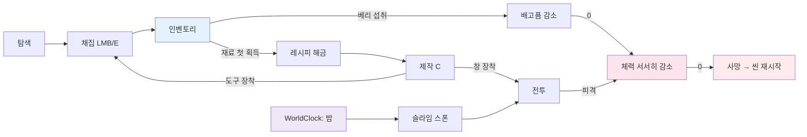

# GDD — 동발 섬 (가칭)

## 1. 컨셉

작고 둥근 클레이 장난감 같은 섬에 떨어진 꼬마 탐험가가 나무·돌·베리를 모으고, 도구를 만들고, 밤마다 나타나는 슬라임과 해변의 게를 피하거나 물리치며 살아남는다. 한 판은 짧고(사망 시 섬 처음부터 재시작), 목표는 "도구를 갖춰 밤을 버티는 것"이다.

- 장르: 3인칭(마우스 자유 시점 궤도 카메라) 생존 크래프트 (MVP)
- 엔진: Godot 4.7.2, GDScript 정적 타입, Forward+
- 비주얼: `docs/art/style-guide.md` (참조: `assets/concept/reference.webp`)
- MVP 제외: 저장/불러오기, 건축, 계절(겨울 섬), 내구도, 사운드(선택)

## 2. 코어 루프

플레이어는 섬을 돌아다니며 맨손으로 나무와 돌을 캔다. 재료를 처음 얻으면 그 재료를 쓰는 레시피가 열린다. 도구를 만들면 채집량이 3배가 되고, 창을 만들면 전투가 쉬워진다. 배고픔은 시간과 활동량에 따라 줄고, 베리로 채운다. 밤이 되면 슬라임이 나타나 쫓아오고, 아침이 되면 녹아 사라진다. 체력이 0이 되면 섬이 처음부터 다시 생성된다(같은 시드).

## 3. 조작

| 입력 | 액션 이름 (InputMap) | 동작 |
|---|---|---|
| W/A/S/D | `move_forward` / `move_left` / `move_back` / `move_right` | 카메라 yaw 기준 이동. 캐릭터는 이동 방향으로 부드럽게 돈다 |
| Shift | `sprint` | 달리기 (배고픔 3배 감소) |
| 마우스 이동 | (액션 없음, `InputEventMouseMotion`) | 마우스 캡처 중에만 카메라 궤도 회전(yaw/pitch) |
| 마우스 휠 위 / 아래 | `camera_zoom_in` / `camera_zoom_out` | 마우스 캡처 중에만 카메라 거리 −/+ 0.75 m |
| E | `interact` | 조준 방향(카메라 수평 정면)의 상호작용 대상(베리 덤불) 사용 |
| 마우스 왼쪽 | `attack` | 캡처 중: 장착 아이템 휘두르기(적 공격 / 나무·바위 채집). 해제 중(패널 닫힘): 게임 화면 클릭 → 마우스 재캡처만, 공격 안 함 |
| Esc | `ui_cancel` (Godot 기본 액션, 추가 등록 불필요) | 패널이 열려 있으면 모두 닫고 플레이로 복귀(재캡처). 패널이 없으면 마우스 해제 |
| Tab | `toggle_inventory` | 인벤토리 열기/닫기 |
| C | `toggle_crafting` | 제작 패널 열기/닫기 |

- 마우스 상태는 세 가지다. **플레이**(캡처, 커서 숨김, 카메라 회전·공격 가능), **자유**(Esc로 해제, 커서 보임), **UI**(패널 열림, 커서 보임). 패널이 하나라도 열리면 UI, 패널이 모두 닫히면 플레이로 돌아간다. 상세 규칙은 `docs/architecture/player-vitals-interaction.md`의 CameraRig 절.
- 인벤토리 슬롯 클릭: 도구면 장착(다시 클릭하면 해제), 음식이면 1개 먹기.
- UI가 열려 있어도 게임은 멈추지 않는다. 키보드 입력(이동·Shift·E)은 계속 동작하고, 카메라 회전·줌·공격은 멈춘다.
- 공격·상호작용 방향은 카메라의 수평 정면(조준 방향)이다. 누르는 순간 캐릭터가 그 방향으로 즉시 돌아선 뒤 판정한다. 화면 중앙 레티클은 두지 않는다(이유는 CameraRig 절).
- 게임패드: MVP 제외. 오른쪽 스틱 시점만 넣으면 슬롯 클릭·제작 버튼 등 나머지 입력이 마우스 전제라 반쪽 지원이 된다.
- **미결정 — 마우스 감도 조절 UI**: (a) MVP에서는 `CameraRig.mouse_sensitivity` `@export` 값만 둠, (b) 설정 패널 추가. 추천 (a) — MVP에 설정 화면이 없다.

## 4. MVP 콘텐츠

### 아이템

| id | 이름 | 분류 | 최대 스택 | 무게 | 효과 / 도구 |
|---|---|---|---|---|---|
| `wood` | 나무 | 재료 | 64 | 1.0 | — |
| `stone` | 돌 | 재료 | 64 | 2.0 | — |
| `berry` | 베리 | 음식 | 64 | 0.2 | 배고픔 +15 |
| `stone_axe` | 돌도끼 | 도구 | 1 | 3.0 | `axe` 등급 1, 피해 10, 사거리 1.8 m |
| `stone_pickaxe` | 돌곡괭이 | 도구 | 1 | 3.0 | `pickaxe` 등급 1, 피해 8, 사거리 1.8 m |
| `wooden_spear` | 나무창 | 무기 | 1 | 2.0 | `spear` 등급 1, 피해 18, 사거리 2.4 m |
| (맨손) | — | — | — | — | 등급 0, 피해 4, 사거리 1.5 m |

### 레시피 (`data/recipes.json`)

| 결과 | 재료 | 해금 조건 |
|---|---|---|
| 돌도끼 ×1 | 나무 3 + 돌 2 | 나무·돌을 각각 한 번 이상 획득 |
| 돌곡괭이 ×1 | 나무 3 + 돌 3 | 나무·돌을 각각 한 번 이상 획득 |
| 나무창 ×1 | 나무 4 | 나무를 한 번 이상 획득 |

### 채집 대상

| 대상 | 방식 | 드롭 | 선호 도구 | 재생 |
|---|---|---|---|---|
| 소나무 / 야자수 | LMB 타격 | 나무 | `axe` | 90초 |
| 바위 | LMB 타격 | 돌 | `pickaxe` | 120초 |
| 베리 덤불 | E 상호작용 | 베리 3개 | — | 60초 |

### 몬스터

| 몬스터 | 등장 | 행동 |
|---|---|---|
| 슬라임 | 밤에만 스폰(플레이어 반경 12 m 밖), 아침에 녹아 사라짐 | 대기 시 근처를 깡충 배회, 20 m 안이면 추적, 28 m 밖이면 포기 |
| 게 | 해변에 항상 3마리, 죽으면 120초 뒤 해변에 재생성 | 해변 순찰 지점 사이 왕복, 6 m 안이면 공격 추적, 집에서 12 m 벗어나면 복귀 |

몬스터는 MVP에서 아이템을 떨어뜨리지 않는다.

### 하루

하루 6분(360초). 낮 240초(06:00~22:00), 밤 120초(22:00~06:00). 시작 시각 08:00. 낮↔밤 조명 전환은 12초 보간.

## 5. 수치 튜닝표

모든 값은 해당 스크립트의 `@export` 기본값으로 둔다(아이템·레시피는 데이터 파일). 이 표가 기본값의 원본이다.

### 플레이어 / Vitals

| 항목 | 값 | 위치 |
|---|---|---|
| 최대 체력 / 최대 배고픔 | 100 / 100 | `Vitals` |
| 걷기 / 달리기 속도 | 4.5 / 7.0 m/s | `Player` |
| 이동 방향 회전 보간 계수 | 12 (`1 - exp(-12·Δt)`) | `Player.turn_speed` |
| 공격·상호작용 후 조준 방향 고정 | 0.3초 | `Player.face_lock_time` |
| 배고픔 기본 감소 | 0.25 /s | `Vitals.hunger_rate` |
| 활동 배수 (정지 / 걷기 / 달리기) | 0.5 / 1.0 / 3.0 | `Vitals` |
| 굶주림(배고픔 ≤ 0) 체력 감소 | 1.0 /s (0→사망 100초) | `Vitals.starve_damage_per_sec` |
| 굶주림 경고 표시 | 배고픔 ≤ 25 | `Vitals.warn_hunger` |
| 자연 회복 | 배고픔 ≥ 60, 마지막 피격 5초 후, 0.5 HP/s | `Vitals` |
| 피격 무적 | 0.5초 | `Player` |
| 공격 쿨다운 | 0.5초 (판정은 휘두른 뒤 0.15초) | `Player` |
| 걷기 기준 배고픔 0까지 | 400초 ≈ 1.1일 | (계산값) |

### 카메라 (`CameraRig`)

| 항목 | 값 |
|---|---|
| 시작 yaw / pitch / 거리 | 35° / −35° / 7 m |
| pitch 범위 | −70° ~ −5° |
| 거리 범위 / 휠 한 칸 | 3 ~ 12 m / 0.75 m |
| 마우스 감도 | 0.15 °/px (`screen_relative` 기준) |
| 세로 FOV / near / far | 50° / 0.1 / 200 |
| 피벗 높이 (플레이어 발 기준) | 0.9 m |
| 위치 추종 / 줌 보간 계수 | 10 / 10 (`1 - exp(-k·Δt)`) |
| SpringArm 구 반지름 / margin | 0.2 m / 0.05 m |

### 채집

| 항목 | 값 |
|---|---|
| 노드 HP (나무·바위) | 6 |
| 타격당 노드 피해 | 맨손 1 / 선호 도구 2 / 다른 도구 1 |
| 타격당 수확량 | 기본 1 × 배수 (맨손 1, 선호 도구 등급1 = 3, 다른 도구 1) |
| 노드 1개 총 수확 | 맨손 6타 → 6개 / 선호 도구 3타 → 9개 |
| 베리 덤불 | E 1회 → 베리 3, 재생 60초 |
| 인벤토리 | 20칸, 스택 64, 최대 무게 200 |

수확량 공식: `amount = base_yield * (3 if tool_type == preferred_tool and tool_tier >= 1 else 1)`.

### 몬스터

| 항목 | 슬라임 | 게 |
|---|---|---|
| HP | 30 | 40 |
| 이동 (배회·순찰 / 추적) | 1.5 / 2.8 m/s | 1.5 / 3.2 m/s |
| 감지 / 포기 반경 | 20 / 28 m | 6 m (어그로), 집 기준 12 m (리쉬) |
| 공격 사거리 / 피해 / 쿨다운 | 1.1 m / 8 / 1.2초 | 1.2 m / 12 / 1.5초 |
| 피격 경직 / 넉백 | 0.25초 / 3 m/s | 0.25초 / 2 m/s |
| 처치 타수 (맨손 / 도끼 / 창) | 8 / 3 / 2 | 10 / 4 / 3 |

### 스폰

| 항목 | 값 |
|---|---|
| 슬라임 스폰 간격 (밤) | 15초 |
| 슬라임 동시 최대 | 6 |
| 스폰 거리 (플레이어 기준) | 14~28 m |
| 안전 반경 (플레이어 / 시작 지점) | 12 m / 10 m |
| 스폰 후보 재시도 | 최대 10회, 실패 시 이번 틱 건너뜀 |
| 게 수 / 재생성 | 3 / 120초 (플레이어 15 m 밖에서만) |

### 월드

| 항목 | 값 |
|---|---|
| 섬 시드 | 20261028 (고정) |
| 섬 기준 반지름 / 격자 | 본섬 28 m(로브로 물가선 20~37 m) + 작은 섬 1개(모래톱 연결) / 90×90 m, 0.5 m 간격 (181×181 정점) |
| 지형 단 높이 | 해변 0~0.40 m, 1단 1.20 m, 2단 2.10 m, 3단 2.90 m, 해저 −2.0 m (절벽 0.8~0.9 m) |
| 고원 수 | 1단 2(본섬·작은 섬), 2단 3, 3단 1 |
| 경사로 | 11개(본섬 1단 4, 작은 섬 1, 2단 2·2·1, 3단 1), 길 폭 3.0 m, 길이 2.4 m, 길 기울기 ≤ 25°, 옆 비탈 30° |
| 해변 폭 | 본섬 5.0 ± 1.2 m, 작은 섬 2.3 m |
| 나무 / 바위 / 덤불 최대 수 | 소나무 30, 야자수 10, 바위 20, 덤불 12 |

## 6. 진행 구조 (MVP)

명시적 승리 조건은 없다. 한 판의 체감 목표는 다음 순서다.

맨손 채집 → 돌도끼·곡괭이 제작(채집 3배) → 나무창 제작 → 베리 확보 → 첫 밤 생존 → 이후 밤 반복

HUD에 "N일차"를 보여 주어 버틴 일수가 점수 역할을 한다.

## 7. 사망과 재시작

체력이 0이 되면 입력이 꺼지고 캐릭터가 쓰러지는 연출(0.6초) 후 "쓰러졌어요…" 문구를 2.5초 보여 주고 `get_tree().reload_current_scene()`으로 재시작한다. 인벤토리·시간은 초기화된다.

체력 0 → 입력 차단 → 쓰러짐 Tween → 문구 2.5초 → 씬 재시작
